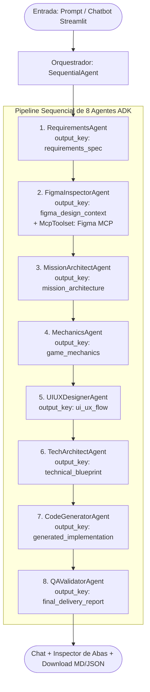

# 🌌 Gerador de Missões — Google ADK Orchestrator com 8 Agentes & Figma MCP

Estrutura **Padrão Ouro** de um sistema multi-agente construído com o framework oficial **Google ADK (Agent Development Kit)**, implementando um pipeline sequencial determinístico de **8 Agentes LLM especializados**, com integração ao **Model Context Protocol (MCP) do Figma** e interface interativa em **Streamlit (Chatbot)**.

---

## 🏗️ Arquitetura do Sistema

O orquestrador central utiliza a classe `SequentialAgent` do Google ADK para garantir que a esteira de criação da missão execute em uma ordem rigorosa e cumulativa. Cada subagente armazena seus dados no estado de sessão compartilhado (`InvocationContext`) através de sua respectiva `output_key`, permitindo que os agentes seguintes consumam o contexto dinamicamente via interpolação `{nome_da_chave}`.



---

## 🤖 Os 8 Agentes do Pipeline

| # | Agente | Arquivo | Responsabilidade | Chave de Saída (`output_key`) | Ferramentas / MCP |
|---|---|---|---|---|---|
| **1** | `RequirementsAgent` | `agents/a1_requirements.py` | Extração de escopo, objetivos funcionais (RF) e restrições | `requirements_spec` | Nenhuma |
| **2** | `FigmaInspectorAgent` | `agents/a2_figma_inspector.py` | Inspeção de frames, tokens de cor, tipografia e componentes | `figma_design_context` | **Figma `McpToolset`** |
| **3** | `MissionArchitectAgent` | `agents/a3_mission_architect.py` | Criação da narrativa (lore), fases e matriz de recompensas | `mission_architecture` | Nenhuma |
| **4** | `MechanicsAgent` | `agents/a4_mechanics.py` | Máquina de estados (FSM), balanceamento e regras lógicas | `game_mechanics` | Nenhuma |
| **5** | `UIUXDesignerAgent` | `agents/a5_ui_ux.py` | Mapeamento de telas, layout do HUD e microinterações | `ui_ux_flow` | Nenhuma |
| **6** | `TechArchitectAgent` | `agents/a6_tech_architect.py` | Blueprint técnico de software, schemas Pydantic e barramento | `technical_blueprint` | Nenhuma |
| **7** | `CodeGeneratorAgent` | `agents/a7_code_generator.py` | Geração de código Python executável, JSON e testes unitários | `generated_implementation` | Nenhuma |
| **8** | `QAValidatorAgent` | `agents/a8_qa_validator.py` | Auditoria de segurança, consistência entre etapas e entrega | `final_delivery_report` | Nenhuma |

---

## 🎨 Integração com o MCP do Figma

A integração é realizada através do `McpToolset` do Google ADK (`tools/figma_mcp.py`):

1. **Servidor Local Stdio:**
   Executa via `npx` o servidor `figma-developer-mcp` (ou `@modelcontextprotocol/server-figma`) com `StdioConnectionParams`.
2. **Fallback Gracioso / Mock:**
   Caso o servidor MCP não esteja instalado localmente ou o usuário esteja em ambiente offline, ferramentas nativas de inspeção garantem que o pipeline continue funcionando sem interrupções.

---

## 📁 Estrutura do Projeto

```
gerador-missoes/
├── .env.example                # Modelo de variáveis de ambiente
├── .env                        # Variáveis locais (API Keys)
├── requirements.txt            # Dependências oficiais (google-adk, streamlit, etc.)
├── config.py                   # Configurações com Pydantic Settings
├── app.py                      # Interface Web Streamlit (Chatbot + Visualizador)
├── test_pipeline.py            # Teste de integridade estrutural do pipeline
├── prompts/                    # Prompts dos 8 agentes em arquivos Markdown (.md)
│   ├── __init__.py
│   ├── loader.py               # Utilitário de carregamento de prompts
│   ├── a1_requirements.md
│   ├── a2_figma_inspector.md
│   ├── a3_mission_architect.md
│   ├── a4_mechanics.md
│   ├── a5_ui_ux.md
│   ├── a6_tech_architect.md
│   ├── a7_code_generator.md
│   └── a8_qa_validator.md
├── tools/
│   ├── __init__.py
│   └── figma_mcp.py            # Fábrica do McpToolset para o Figma
├── agents/
│   ├── __init__.py
│   ├── base.py                 # Fábrica padronizada de LlmAgent
│   ├── a1_requirements.py      # Agente 1 (lê prompts/a1_requirements.md)
│   ├── a2_figma_inspector.py   # Agente 2 (lê prompts/a2_figma_inspector.md)
│   ├── a3_mission_architect.py # Agente 3 (lê prompts/a3_mission_architect.md)
│   ├── a4_mechanics.py         # Agente 4 (lê prompts/a4_mechanics.md)
│   ├── a5_ui_ux.py             # Agente 5 (lê prompts/a5_ui_ux.md)
│   ├── a6_tech_architect.py    # Agente 6 (lê prompts/a6_tech_architect.md)
│   ├── a7_code_generator.py    # Agente 7 (lê prompts/a7_code_generator.md)
│   └── a8_qa_validator.py      # Agente 8 (lê prompts/a8_qa_validator.md)
└── pipeline/
    ├── __init__.py
    ├── orchestrator.py         # Montagem do SequentialAgent
    └── runner.py               # Execução assíncrona com streaming de eventos
```

---

## 🚀 Como Executar

### 1. Pré-requisitos
- Python 3.10+
- Node.js & `npx` (para o servidor MCP do Figma)

### 2. Instalação das Dependências
```bash
# Criar ambiente virtual
python3 -m venv .venv
source .venv/bin/activate

# Instalar dependências
pip install -r requirements.txt
```

### 3. Configuração de Variáveis de Ambiente
Copie o arquivo de exemplo e insira suas chaves:
```bash
cp .env.example .env
```
Edite o arquivo `.env`:
```env
# Google Gemini API
GOOGLE_API_KEY="SUA_CHAVE_GEMINI_AQUI"
GEMINI_MODEL="gemini-3.7-flash"

# Controle de Pensamento / Raciocínio (Thinking Config - Gemini 3.7 Flash)
THINKING_BUDGET=2048
INCLUDE_THOUGHTS=true

# Token e Pasta do Figma
FIGMA_API_KEY="figd_rMIFyOVjCI6oc_EzTG1EYZE7GDEu0LeR_RGL4J6l"
FIGMA_DEFAULT_FOLDER_URL="https://www.figma.com/files/team/1669801444374741311/folder/648533591?fuid=1669362530798509991"
FIGMA_FOLDER_ID="648533591"
FIGMA_TEAM_ID="1669801444374741311"
```

### 4. Executar Teste Estrutural
```bash
python test_pipeline.py
```

### 5. Iniciar a Interface Streamlit
```bash
streamlit run app.py
```
Acesse no seu navegador: `http://localhost:8501`.

