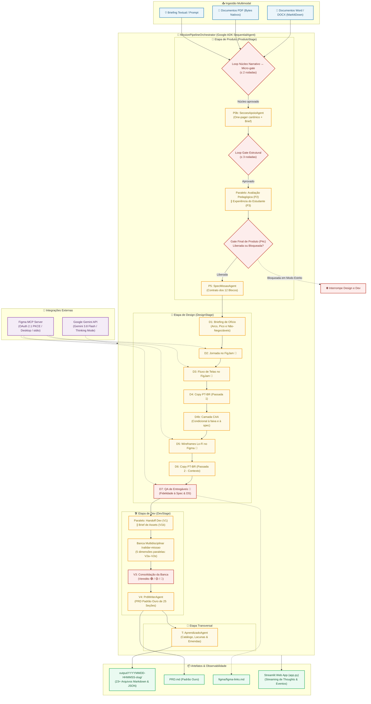
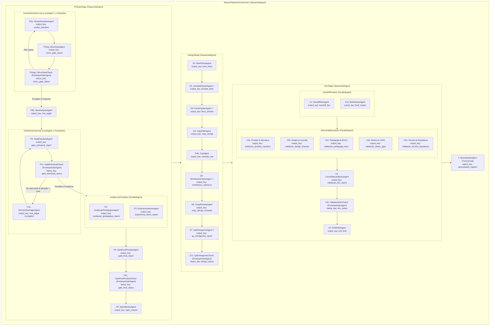

# 🌌 Gerador de Missões Unooria — Produto → Design → Dev

Pipeline multiagente de nível de produção construído com o **Google ADK (Agent Development Kit)** e modelos **Google Gemini** (com suporte a *Thinking Mode* nativo). O sistema traduz a ideia bruta ou o *one-pager* de uma missão de letramento digital em um **PRD (Product Requirements Document) padrão ouro com 25 seções**, complementado por especificações de design, fluxos no FigJam, wireframes no Figma e validação técnica por banca multidisciplinar, pronto para alimentar agentes de codificação no monorepo `plataforma-unooria`.

---

## 📑 Sumário

- [Visão Geral e Proposta de Valor](#-visão-geral-e-proposta-de-valor)
- [Diagramas de Arquitetura](#-diagramas-de-arquitetura)
  - [1. Macroarquitetura End-to-End](#1-macroarquitetura-end-to-end)
  - [2. Hierarquia de Agentes e Estado do ADK](#2-hierarquia-de-agentes-e-estado-do-adk)
  - [3. Ciclo de Gates e Controle Determinístico](#3-ciclo-de-gates-e-controle-determinístico)
- [Detalhamento das Áreas e Agentes](#-detalhamento-das-áreas-e-agentes)
  - [🧭 Área de Produto](#-área-de-produto)
  - [🎨 Área de Design & Integração Figma MCP](#-área-de-design--integração-figma-mcp)
  - [🛠️ Área de Dev & Banca de Validação](#-área-de-dev--banca-de-validação)
  - [🧠 Área Transversal de Aprendizado](#-área-transversal-de-aprendizado)
- [Controle de Fluxo Determinístico e Anti-Alucinação](#-controle-de-fluxo-determinístico-e-anti-alucinação)
- [Processamento Multimodal de Documentos](#-processamento-multimodal-de-documentos)
- [Integração Figma MCP (Model Context Protocol)](#-integração-figma-mcp-model-context-protocol)
- [Artefatos Gerados e o PRD Padrão Ouro](#-artefatos-gerados-e-o-prd-padrão-ouro)
- [Contexto da Plataforma Unooria](#-contexto-da-plataforma-unooria)
- [Interface Streamlit e Histórico de Sessões](#-interface-streamlit-e-histórico-de-sessões)
- [Configuração e Variáveis de Ambiente](#-configuração-e-variáveis-de-ambiente)
- [Guia Operacional: Instalação, Execução e Testes](#-guia-operacional-instalação-execução-e-testes)
- [Docker e Deploy no Cloud Run](#-docker-e-deploy-no-cloud-run)

---

## 🚀 Visão Geral e Proposta de Valor

Criar uma missão educacional interativa de alta imersão para a plataforma Unooria exige alinhar **quatro domínios complexos**:
1. **Pedagogia & BNCC:** aderência à Base Nacional Comum Curricular, adequação à faixa etária (4º ao 9º ano EF), descoberta central autêntica, agência real do estudante e papel docente mediador com *checkpoints* flexíveis.
2. **Design de Experiência & Ofício:** simulação fiel de ambientes reais (Instagram, YouTube, TikTok, WhatsApp, ChatGPT), arco dramático, picos de tensão, inventário de telas e conformidade com o Design System `@unooria/design-system`.
3. **Engenharia de Software & Arquitetura:** modelo de dados em três camadas (Missão, Etapa, Desafio), contratos de API Zod/OpenAPI, protocolo de comunicação iframe via `postMessage`, telemetria operacional/analítica e conformidade estrita com o Art. 14 da LGPD (dados de menores).
4. **Viabilidade Técnica do Monorepo:** caminhos reais de código em Next.js 16, NestJS, Prisma/PostgreSQL, TypeScript e Docker.

O **Gerador de Missões** automatiza essa cadeia por meio de uma equipe de **19 agentes especializados** organizados em uma estrutura hierárquica sequencial, com loops de autocorreção, bifurcações paralelas de validação e *gates* determinísticos sem inferência de LLM.

```
Briefing / Ideia (+ PDF / DOCX)
    │
    ▼
[ PRODUTO ] ──▶ [ DESIGN ] ──▶ [ DEV ] ──▶ [ APRENDIZADO ]
  One-pager       Briefing        Handoff       Catálogo
  Gate (Loop)     Jornada         Assets        Padrões
  Avaliações (∥)  Fluxo           Banca (5 ∥)   Lacunas
  Gate Final      Copy (1 e 2)    Consolidação
  Spec (12 bl.)   Wireframes      PRD Ouro (25s)
                  QA Entregáveis
```

---

## 📐 Diagramas de Arquitetura

### 1. Macroarquitetura End-to-End

O diagrama a seguir ilustra o ciclo de vida completo da informação, desde a ingestão multimodal até a geração final dos artefatos em disco e na interface gráfica:



---

### 2. Hierarquia de Agentes e Estado do ADK

No Google ADK, os agentes trocam dados exclusivamente por meio de chaves no dicionário `session.state`. O diagrama a seguir expõe a hierarquia de contenção e o fluxo de chaves de estado de ponta a ponta:



---

### 3. Ciclo de Gates e Controle Determinístico

Um dos maiores desafios em pipelines multiagente é a propagação de erros e alucinações. O Gerador de Missões resolve isso com **Gates Determinísticos BaseAgent**, que isolam a decisão lógica do modelo generativo:


---

## 🔍 Detalhamento das Áreas e Agentes

### 🧭 Área de Produto

A área de Produto garante que nenhuma missão siga para concepção visual ou codificação sem clareza pedagógica, consistência com as diretrizes da Unooria e logística de sala de aula viável.

| Agente | ID | Tipo / Container | Insumos (`session.state`) | Saída (`output_key`) | Responsabilidade Central |
|---|---|---|---|---|---|
| **Núcleo narrativo** | `P0a` | `LlmAgent` (Loop) | `user_message` (Prompt + PDFs/DOCX), `{micro_gate_report?}` | `nucleo_narrativo` | Escreve só as seções 0, 1, 3 e 4 — descoberta central, narrativa e as 6 etapas — para isolar o raciocínio criativo da formatação. É o **único** agente com `include_contents="default"` para receber os anexos originais. Reescreve o trecho apontado quando o micro-gate reprova. |
| **Micro-gate do núcleo** | `P0mg` | `LlmAgent` (Loop) | `{nucleo_narrativo}` | `micro_gate_report` | Quatro verificações binárias: spoiler (4 padrões), gap de informação real, escolha significativa (4 testes) e job-to-be-done no Desafiar. Emite o envelope JSON com `passa`/`nao_passa`. |
| **Veredito do micro-gate** | `P0mgc` | Determinístico | `{micro_gate_report}` | `micro_gate_status` | Aprovado encerra o loop e libera o P0b; reprovado devolve o núcleo ao P0a. Teto de 2 rodadas; esgotado, segue com o achado registrado — quem bloqueia a missão é o gate estrutural. |
| **Seções de apoio e brief** | `P0b` | `LlmAgent` | `{nucleo_narrativo}`, `{briefing?}` | `one_pager` | Completa o one-pager canônico (seções 2 e 5–18) sobre o núcleo aprovado, sem alterar as seções validadas, e entrega junto o brief de escopo para leitura rápida. |
| **Gate estrutural** | `P1` | `LlmAgent` (Loop) | `{one_pager}` | `gate_estrutural_report` | Avalia **23 critérios** obrigatórios agrupados em: Estrutura, Ambiente simulado, Logística e tempo, Evidências e Fechamento de spec. Emite o envelope JSON. |
| **Veredito do gate estrutural** | `P1c` | `EnvelopeGateAgent` (Determinístico) | `gate_estrutural_report` | `gate_estrutural_status` | Analisa o envelope. Se aprovado, encerra o loop; se reprovado, aciona o revisor; se esgotar as 3 rodadas em modo estrito, bloqueia o pipeline. |
| **Revisor do one-pager** | `P1b` | `LlmAgent` (Loop) | `{one_pager}`, `{gate_estrutural_report}` | `one_pager` | Aplica as correções sugeridas no relatório do gate estrutural ("complemento pronto para colar"). **Nunca inventa decisões de negócio (marcadas como 🔵)**. |
| **Avaliação pedagógica** | `P2` | `LlmAgent` (Paralelo) | `{one_pager}` | `avaliacao_pedagogica_report` | Checa a descoberta central, o alinhamento à BNCC (habilidades de Língua Portuguesa e Computação), o papel docente mediador e a tensão *affordance × guardrail*. |
| **Experiência do aluno** | `P3` | `LlmAgent` (Paralelo) | `{one_pager}` | `experiencia_aluno_report` | Valida a adequação etária (cognitiva e motora), vocabulário, carga de leitura, agência e relevância cultural para o estudante. |
| **Gate final de produto** | `P4` | `LlmAgent` | `{one_pager}`, relatórios de P1, P2 e P3 | `gate_final_report` | Valida a coerência cruzada entre todos os pareceres anteriores. Emite o veredito definitivo: 🟢 LIBERADA ou 🔴 BLOQUEADA. |
| **Veredito final de produto** | `P4c` | `EnvelopeGateAgent` (Determinístico) | `gate_final_report` | `gate_final_status` | Registra a liberação ou bloqueio no estado global e sinaliza `skip_if_blocked` se modo estrito estiver ativo. |
| **Spec da missão** | `P5` | `LlmAgent` | `{one_pager}`, `{gate_final_report}` | `spec_missao` | Converte o one-pager aprovado no contrato técnico dos **12 blocos de construção**, contra o qual Design e Dev construirão. |

---

### 🎨 Área de Design & Integração Figma MCP

A área de Design recebe a `spec_missao` e a transforma em especificações de interface e jornada, gerando arquivos reais ou boards no Figma/FigJam quando o MCP está conectado.

| Agente | ID | Ferramentas | Saída (`output_key`) | Responsabilidade Central |
|---|---|---|---|---|
| **Briefing de ofício** | `D1` | — | `brief_oficio` | Extrai o arco dramático da missão: gancho inicial, pico de engajamento, beat memorável de ofício e não-negociáveis de imersão. |
| **Jornada no FigJam** | `D2` | 🎨 `FIGMA_TOOLS_JORNADA` | `jornada_telas` | Constrói a matriz de jornada (Raias × 6 Etapas), define cenários por dispositivo, inventário completo de telas e direção de arte por tela. |
| **Fluxo de telas no FigJam** | `D3` | 🎨 `FIGMA_TOOLS_FLUXO` | `fluxo_arestas` | Modela o grafo de estados e transições de tela com condições, gates de validação e execução dos **5 testes de fluxo** (caminho feliz, erro, desistência, recálculo e retorno). |
| **Copy PT-BR (Passada 1)** | `D4` | — | `copy_strings` | Redige todas as strings e microtextos da interface organizados por identificador de tela, calibrados para a linguagem da faixa etária. |
| **Camada CAA** | `D4b` | — | `camada_caa` | Comunicação aumentativa e alternativa: aplica um gate de aplicabilidade (faixa 1º–2º ano, ou spec/briefing que citem pré-leitores, CAA ou PEI) e, quando roda, define símbolo por conceito, modo de resposta alternativo por decisão, pranchas nos escapes e restrições de toque para o wireframe. Fora dessas condições devolve `nao_aplicavel`. |
| **Wireframes lo-fi no Figma** | `D5` | 🎨 `FIGMA_TOOLS_WIREFRAMES` | `wireframes_cobertura` | Monta os wireframes em escala de cinza sobre os componentes do Design System do ambiente simulado (`@unooria/design-system`). |
| **Copy PT-BR (Passada 2)** | `D6` | — | `copy_strings_revisada` | Revisa cada texto inserido no contexto da tela montada, ajustando densidade, quebras de linha e tom de voz. |
| **QA de entregáveis** | `D7` | 🎨 `FIGMA_TOOLS_QA` | `qa_entregaveis_report` | Auditoria rigorosa de conformidade contra a spec original, diff de strings, respeito ao Design System e critérios de ofício O1–O5. |
| **Veredito de design** | `D7c` | Determinístico | `design_status` | Lê o envelope do QA de design. Não bloqueia a etapa de dev; eventuais ressalvas são herdadas pelo PRD. |

---

### 🛠️ Área de Dev & Banca de Validação

A etapa de Dev materializa o handoff para a equipe de tecnologia e submete a missão a uma **banca multidisciplinar com 72 critérios de validação (21 bloqueantes)** antes de lavrar o PRD padrão ouro.

```
                    ┌─ HandoffDevAgent (V1)
                    │  BriefAssetsAgent (V1b)
                    │
                    ▼
┌───────────────────────────────────────────────────────────┐
│     Banca de Validação Multidisciplinar (5 em paralelo)   │
│                                                           │
│  [V2a] Produto & Narrativa  ──────▶ PROD-01 … 16 (4 bloq) │
│  [V2b] Design & Imersão     ──────▶ DES-01 … 13  (4 bloq) │
│  [V2c] Pedagogia & BNCC     ──────▶ PED-01 … 15  (5 bloq) │
│  [V2d] Dados & LGPD         ──────▶ DAD-01 … 15  (4 bloq) │
│  [V2e] Técnica & Monorepo   ──────▶ TEC-01 … 13  (4 bloq) │
└───────────────────────────────────────────────────────────┘
                    │
                    ▼
         ConsolidacaoBancaAgent (V3)
         Veredito: 🟢 APTO | 🟡 APTO C/ RESSALVAS | 🔴 NÃO APTO
                    │
                    ▼
         PrdWriterAgent (V4) ──▶ PRD.md (25 Seções)
```

| Agente | ID | Critérios / Rubrica | Saída (`output_key`) | Descrição |
|---|---|---|---|---|
| **Handoff para dev** | `V1` | Modelo de Insumo | `handoff_dev` | Preenche o modelo de insumo com User Stories fechadas (com travas 🔒), catálogo de eventos de telemetria e escopo V1 vs V2. |
| **Brief de assets** | `V1b` | Rubrica de Assets | `brief_assets` | Inventário completo de produção: imagens, áudios, mockups, critérios de reprovação e ordem de criação. |
| **Banca: Produto & Narrativa** | `V2a` | `PROD-01` a `16` (4 bloqueantes) | `validacao_produto_narrativa` | Avalia clareza do problema, coerência narrativa, loop de engajamento e métricas de sucesso. |
| **Banca: Design & Imersão** | `V2b` | `DES-01` a `13` (4 bloqueantes) | `validacao_design_imersao` | Avalia fidelidade ao ambiente simulado, consistência de layout e acessibilidade visual. |
| **Banca: Pedagogia & BNCC** | `V2c` | `PED-01` a `15` (5 bloqueantes) | `validacao_pedagogia_bncc` | Avalia alinhamento rigoroso à BNCC, profundidade conceitual e rubricas de avaliação formativa. |
| **Banca: Dados & LGPD** | `V2d` | `DAD-01` a `15` (4 bloqueantes) | `validacao_dados_lgpd` | Avalia telemetria analítica (xAPI), proteção de dados de menores (LGPD Art. 14) e retenção. |
| **Banca: Técnica & Arquitetura** | `V2e` | `TEC-01` a `13` (4 bloqueantes) | `validacao_tecnica_arquitetura` | Avalia compatibilidade com o monorepo NestJS/Next.js 16, performance e contratos de API. |
| **Consolidação da banca** | `V3` | Matriz de Decisão | `validacao_dev_report` | Consolida os relatórios em veredito único determinístico (🟢 / 🟡 / 🔴). |
| **Veredito de dev** | `V3c` | Determinístico | `dev_status` | Normaliza e registra o status da banca no estado da sessão. |
| **Redator do PRD** | `V4` | Gabarito de 25 seções | `prd_final` | **O grande entregável do pipeline**: PRD completo com contexto arquitetural real da plataforma Unooria. |

---

### 🧠 Área Transversal de Aprendizado

- **Agente de Aprendizado (`AprendizadoAgent` / `T`):**
  - Roda ao final de toda execução (mesmo que haja bloqueios ou ressalvas).
  - Atualiza o registro em `output/<execucao>/aprendizado.md`.
  - Extrai:
    1. **Linha do Catálogo de Missões:** metadados normalizados da missão para o catálogo geral.
    2. **Padrões de Sucesso:** soluções criativas encontradas para conciliar BNCC e mecânica de jogo.
    3. **Lacunas por Classe:** problemas reincidentes com identificação de causa-raiz.
    4. **Candidatos a Critério:** propostas formais de novos critérios de gate para as referências do repositório.
  - *Regra de ouro:* O agente de aprendizado **nunca altera diretamente os prompts dos agentes**; ele escreve propostas estruturadas para revisão humana.

---

## 🛡️ Controle de Fluxo Determinístico e Anti-Alucinação

Para garantir que o pipeline funcione como uma esteira industrial confiável, adotamos regras estritas de engenharia de contexto no ADK:

1. **Isolamento Total de Contexto (`include_contents="none"`):**
   - No Google ADK, agentes configurados com `include_contents="default"` herdam o histórico completo de conversação do runner, gerando poluição contextual e alucinações cumulativas.
   - No Gerador de Missões, **todos os agentes (exceto P0a) operam com `include_contents="none"`**. Eles recebem única e exclusivamente os dados necessários explicitamente interpolados em seu prompt de sistema através das variáveis `{chave}` do `session.state`.
2. **Interpolação Segura com Fallback (`{chave?}`):**
   - Variáveis com `{chave}` estrita falham imediatamente se a chave não existir no estado.
   - Variáveis marcadas com `{chave?}` degradam graciosamente se a etapa correspondente não tiver sido executada (ex.: rodar diretamente a etapa de Dev).
3. **Contrato de Envelope JSON:**
   - Todo relatório de gate encerra obrigatoriamente com o envelope JSON padronizado:
     ```json
     ```json
     {
       "status": "aprovado | bloqueado | apto_com_ressalvas",
       "veredito": "🟢 LIBERADA PARA DESIGN/DEV",
       "criterios_reprovados": [],
       "bloqueios": []
     }
     ```
     ```
4. **Decisões de Produto Protegidas (🔵):**
   - Decisões estratégicas de produto que dependem de premissas de negócio não fornecidas no briefing são categorizadas com a tag `[DECISÃO PENDENTE — responsável de produto]`. Os agentes são proibidos de inventar tais decisões.

---

## 📄 Processamento Multimodal de Documentos

O módulo [`tools/doc_parser.py`](file:///Users/lucassalomao/Documents/Unooria/gerador-missoes/tools/doc_parser.py) processa documentos anexados pelo usuário com alto desempenho:

- **PDFs Nativos:** Injetados diretamente em formato binário como partes `types.Part.from_bytes(data, mime_type="application/pdf")`, aproveitando a capacidade multimodal nativa do Gemini para interpretação de diagramas, tabelas e layouts visuais.
- **Word (DOCX/DOC):** Convertidos para Markdown estruturado via **Microsoft MarkItDown**, preservando tabelas, listas e títulos sem perda semântica.
- **Limites de Segurança:** Validação estrita de lote: máximo de **10 arquivos** e limite agregado de **25 MB**.

---

## 🎨 Integração Figma MCP (Model Context Protocol)

O módulo [`tools/figma_mcp.py`](file:///Users/lucassalomao/Documents/Unooria/gerador-missoes/tools/figma_mcp.py) conecta os agentes de design ao ecossistema do Figma através da especificação aberta do **Model Context Protocol (MCP)**:

| Modo (`FIGMA_MCP_MODE`) | Transporte | Permissões | Como Configurar |
|---|---|---|---|
| **`remote`** | Streamable HTTP (`https://mcp.figma.com/mcp`) | **Escrita total & Leitura** (`use_figma`, `create_new_file`, `generate_diagram`, FigJam, skills) | Execute `python scripts/figma_oauth.py` uma vez. O token OAuth 2.1 com PKCE é gravado em `.figma_mcp_tokens.json` e renovado automaticamente. |
| **`desktop`** | HTTP Local (`http://127.0.0.1:3845/mcp`) | Leitura de contexto e seleção ativa via app Figma Desktop | Ative a opção "Start Desktop MCP Server" nas configurações do aplicativo desktop do Figma. |
| **`stdio`** | Processo local via `npx` (`figma-developer-mcp`) | Leitura (`get_figma_data`, `download_figma_images`) | Configure `FIGMA_API_KEY` (Personal Access Token) no `.env`. Requer Node.js 20+. |
| **`off`** *(padrão)* | Sem conexão | Nenhuma ferramenta externa | Agentes operam em modo desacoplado, gerando diagramas em sintaxe **Mermaid** e especificações completas em Markdown. |
| **`auto`** | Detecção dinâmica | Adaptativo | Escolhe `remote` se houver tokens salvos; senão `stdio` se houver `FIGMA_API_KEY`; senão `off`. |

*Nota:* Os links e nós gerados no Figma são automaticamente rastreados e consolidados em `figma/figma-links.md` e `figma/figma-links.json`.

---

## 📦 Artefatos Gerados e o PRD Padrão Ouro

Toda execução bem-sucedida persiste uma árvore de entregáveis isolada em `output/<data-hora>-<slug-da-missao>/`:

```
output/20260904-143000-exp-04-fake-news/
├── PRD.md                             # 📘 O PRD Padrão Ouro (25 seções)
├── aprendizado.md                     # 🧠 Registro de aprendizado e catálogo
├── briefing-original.md               # 💡 Insumo original enviado pelo usuário
├── estado.json                        # 🔍 Estado completo serializado (session.state)
├── manifesto-artefatos.json           # 📋 Metadados de todos os arquivos gerados
├── produto/
│   ├── 00a-nucleo-narrativo.md        # Seções 0, 1, 3 e 4 (núcleo criativo)
│   ├── 00b-micro-gate.md              # Spoiler, gap, escolha e job-to-be-done
│   ├── 00-one-pager.md                # One-pager canônico + brief de escopo
│   ├── 01-gate-estrutural.md          # Relatório de 23 critérios e envelope
│   ├── 02-avaliacao-pedagogica.md     # Parecer BNCC e mediação docente
│   ├── 03-experiencia-aluno.md        # Parecer de adequação etária e agência
│   ├── 04-gate-final.md               # Liberação formal de produto
│   └── 05-spec-missao.md              # Contrato dos 12 blocos de construção
├── design/
│   ├── 01-briefing-oficio.md          # Arco dramático e picos de engajamento
│   ├── 02-jornada-telas.md            # Raias × 6 etapas e inventário
│   ├── 03-fluxo-arestas.md            # Grafo de estados e os 5 testes
│   ├── 04-copy-strings.md             # Dicionário de strings (passada 1)
│   ├── 04b-camada-caa.md              # Símbolos, modos de resposta e pranchas (se aplicável)
│   ├── 05-wireframes-cobertura.md     # Cobertura dos wireframes e DS
│   ├── 06-copy-strings-revisada.md    # Revisão contextualizada de copy
│   └── 07-qa-entregaveis.md           # Auditoria de fidelidade e ofício
├── dev/
│   ├── 01-handoff-dev.md              # User stories fechadas e telemetria
│   ├── 01b-brief-assets.md            # Especificação para produção de assets
│   ├── 02a-banca-produto-narrativa.md # Validação PROD-01…16
│   ├── 02b-banca-design-imersao.md    # Validação DES-01…13
│   ├── 02c-banca-pedagogia-bncc.md    # Validação PED-01…15
│   ├── 02d-banca-dados-lgpd.md        # Validação DAD-01…15
│   ├── 02e-banca-tecnica-arquitetura.md # Validação TEC-01…13
│   └── 03-banca-consolidada.md        # Veredito consolidado da banca
└── figma/                             # (Opcional, quando Figma MCP ativo)
    ├── figma-links.md                 # Sumário de URLs, fileKeys e node IDs
    └── figma-links.json               # Metadados estruturados dos links
```

### As 25 Seções do PRD Padrão Ouro

O arquivo **`PRD.md`** segue rigorosamente a especificação definida em [`prompts/references/prd-padrao-ouro.md`](file:///Users/lucassalomao/Documents/Unooria/gerador-missoes/prompts/references/prd-padrao-ouro.md), sintetizando metodologias da SVPG (Marty Cagan), Google Design Docs, EARS, Gherkin, C4 Model, INVEST e requisitos do Art. 14 da LGPD:

1. **Frontmatter YAML:** Metadados, status dos gates, versão e data.
2. **Resumo Executivo:** Problema, solução, público-alvo e métrica de sucesso.
3. **Objetivos & KPIs:** Objetivos pedagógicos e de engajamento mensuráveis.
4. **Não-Objetivos:** Limites claros do escopo (o que NÃO será feito).
5. **Personas & Contexto de Uso:** Estudante e docente no laboratório ou sala de aula.
6. **As 6 Etapas da Missão:** Arco narrativo detalhado passo a passo.
7. **Máquina de Estados & Regras de Transição:** Diagrama e tabela de transições.
8. **User Stories (INVEST & 🔒):** Histórias com critérios de aceite inequívocos.
9. **Requisitos Funcionais (RF) com EARS:** Requisitos com sintaxe formal EARS.
10. **Requisitos Não-Funcionais (RNF):** Performance, acessibilidade WCAG e disponibilidade.
11. **UX & UI:** Links do Figma/FigJam e mapeamento de componentes do Design System.
12. **Modelo de Dados (Prisma/PostgreSQL):** Esquema relacional das entidades da missão.
13. **Contratos de API (Zod/OpenAPI):** DTOs e endpoints documentados.
14. **Telemetria & Eventos (xAPI):** Dicionário de eventos analíticos e operacionais.
15. **Alinhamento Pedagógico & BNCC:** Habilidades mapeadas e rubrica formativa.
16. **Dependências & Integrações:** Bibliotecas e microsserviços necessários.
17. **Arquitetura da Solução:** Diagrama de componentes e comunicação postMessage.
18. **Plano de Implementação no Monorepo:** Tarefas organizadas por caminhos reais de arquivo.
19. **Tarefas de Código com Verificação:** Comandos exatos para validar cada tarefa (`pnpm test`, etc.).
20. **Riscos & Pendências:** Matriz de riscos e itens `[DECISÃO PENDENTE]`.
21. **Decisões Arquiteturais (ADRs):** Registro de justificativas técnicas adotadas.
22. **Estratégia de Testes:** Plano de testes unitários, E2E e de integração.
23. **Definition of Done (DoD):** Critérios objetivos para considerar a missão pronta.
24. **Plano de Rollout:** Estratégia de lançamento gradual e feature flags.
25. **Glossário & Apêndices:** Terminologia do universo Unooria e referências.

---

## 🏛️ Contexto da Plataforma Unooria

O redator do PRD e a banca de desenvolvedores utilizam referências técnicas vivas da engenharia da Unooria, mantidas em `prompts/references/`:

- **[`plataforma-unooria-software.md`](file:///Users/lucassalomao/Documents/Unooria/gerador-missoes/prompts/references/plataforma-unooria-software.md):** Estrutura do monorepo (Turborepo, pnpm), Next.js 16, NestJS, Prisma 5, PostgreSQL 16 com RLS, SDK de comunicação via `postMessage`, canais de telemetria e o ciclo completo de implementação de uma nova missão.
- **[`plataforma-unooria-infra.md`](file:///Users/lucassalomao/Documents/Unooria/gerador-missoes/prompts/references/plataforma-unooria-infra.md):** Arquitetura GCP (Cloud Run, Cloud SQL, Cloud Storage para assets, Pub/Sub para telemetria, Secret Manager, Cloud Armor e conformidade com a LGPD).
- **[`plataforma-unooria-design-system.md`](file:///Users/lucassalomao/Documents/Unooria/gerador-missoes/prompts/references/plataforma-unooria-design-system.md):** Especificação do `@unooria/design-system`, tokens CSS, componentes base, paleta das seis marcas de produtos e gabarito para simulação de interfaces de terceiros.

---

## 💻 Interface Streamlit e Histórico de Sessões

A aplicação conta com uma interface visual completa em [Streamlit](file:///Users/lucassalomao/Documents/Unooria/gerador-missoes/app.py):

- **Streaming em Tempo Real:** Acompanhamento da execução nó a nó, com separação clara entre a saída final de cada agente e seu **fluxo de pensamento (*thinking*)**.
- **Indicadores de Status dos Gates:** Badges coloridas (🟢 Aprovado, 🟡 Aprovado com Ressalvas / Bypass, 🔴 Bloqueado, ⚪ Pendente).
- **Abas Especializadas:** Navegação entre PRD renderizado, relatórios de Produto, especificações de Design, banca de Dev, registro de Aprendizado e links do Figma.
- **Histórico Persistente de Missões:** As execuções salvas em `output/` são carregadas na barra lateral, permitindo revisitar missões anteriores, inspecionar estados passados, excluir execuções ou baixar um **arquivo ZIP completo** com todos os artefatos.
- **Editor de Prompts com Includes Resolvidos:** Uma aba dedicada permite inspecionar e editar qualquer arquivo `.md` de prompt ou referência, com pré-visualização em tempo real das diretivas `<!-- include: references/... -->` expandidas.

---

## ⚙️ Configuração e Variáveis de Ambiente

Crie um arquivo `.env` na raiz do projeto a partir do [`.env.example`](file:///Users/lucassalomao/Documents/Unooria/gerador-missoes/.env.example):

| Variável | Padrão | Descrição |
|---|---|---|
| `GOOGLE_API_KEY` | *Obrigatório* | Chave de API do Google Gemini (Google AI Studio ou Vertex AI). |
| `GEMINI_MODEL` | `gemini-3.8-flash` | Modelo padrão utilizado por todos os agentes do pipeline. |
| `GEMINI_MODEL_PRD` | `gemini-3.8-flash` | Modelo utilizado pelo redator do PRD (pode ser definido como `gemini-3.8-pro`). |
| `THINKING_BUDGET` | `2048` | Tokens dedicados ao raciocínio lógico (`0` = desligado, `-1` = dinâmico, `>0` = fixo). |
| `INCLUDE_THOUGHTS` | `true` | Exibe o fluxo de pensamentos dos agentes na interface gráfica. |
| `PIPELINE_STAGES` | `produto,design,dev` | Etapas ativas separadas por vírgula (a etapa de aprendizado roda sempre). |
| `PRODUTO_MODO_ESTRITO` | `true` | Se `true`, bloqueio em gate de produto encerra o pipeline impedindo design e dev. |
| `GATE_ESTRUTURAL_MAX_RODADAS` | `3` | Número máximo de ciclos entre o Gate Estrutural e o Revisor do One-pager. |
| `OUTPUT_DIR` | `output` | Diretório local para gravação persistente dos artefatos. |
| `FIGMA_MCP_MODE` | `auto` | Modo do Figma MCP: `auto`, `remote`, `desktop`, `stdio` ou `off`. |
| `FIGMA_API_KEY` | — | Personal Access Token do Figma (necessário para o modo `stdio`). |
| `FIGMA_MCP_REMOTE_URL` | `https://mcp.figma.com/mcp` | Endpoint oficial do servidor MCP remoto do Figma. |
| `FIGMA_MCP_DESKTOP_URL` | `http://127.0.0.1:3845/mcp` | Endpoint local do aplicativo Figma Desktop. |
| `FIGMA_DS_FILE_KEY` | `mPw4Hhx9ptkgcHtySaSilO` | fileKey do Design System Unooria no Figma. |
| `FIGMA_DS_V02_FILE_KEY` | `i0HRQSBtQQ9ZXDYiJPRnGv` | fileKey do Design System v0.2 no Figma. |

---

## 🛠️ Guia Operacional: Instalação, Execução e Testes

### Pré-requisitos
- **Python 3.11+**
- **Node.js 20+** (necessário apenas se for utilizar o Figma MCP em modo `stdio` via `npx`)

### 1. Clonar e Instalar Dependências

```bash
# Criar ambiente virtual
python3 -m venv .venv
source .venv/bin/activate

# Instalar dependências
pip install --upgrade pip
pip install -r requirements.txt

# Configurar variáveis de ambiente
cp .env.example .env
# Edite o .env e insira sua GOOGLE_API_KEY
```

### 2. Executar a Suíte de Testes Automatizados

O repositório inclui testes unitários e estruturais completos que validam prompts, interpolação de estado, integridade dos agentes e persistência sem efetuar chamadas externas à LLM:

```bash
# 1. Testes estruturais do pipeline e dos prompts
python test_pipeline.py

# 2. Testes de persistência de artefatos e histórico de sessões
python test_session_artifacts.py
```

### 3. Iniciar a Interface Web

```bash
streamlit run app.py
```

Acesse no navegador: `http://localhost:8501`.

### 4. Execução Programática via Python (CLI / Scripts)

Também é possível executar o pipeline diretamente em scripts Python ou rotinas automatizadas:

```python
from pipeline.runner import run_orchestrator_pipeline_sync

resultado = run_orchestrator_pipeline_sync(
    prompt="Missão sobre fake news e checagem de fontes no YouTube para o 6º ano do EF...",
    stages=["produto", "design", "dev"],
    modo_estrito=True,
    thinking_budget=2048,
)

print(f"Status Final: {resultado.status_icon} {resultado.status}")
print(f"Diretório de Saída: {resultado.output_dir}")
print(f"Gates: {resultado.gates}")
```

---

## 🐳 Docker e Deploy no Cloud Run

O projeto conta com um [`Dockerfile`](file:///Users/lucassalomao/Documents/Unooria/gerador-missoes/Dockerfile) otimizado em multi-stage baseado em `python:3.11-slim`, já incluindo Node.js 20 para suporte integral ao Figma MCP.

### Construir e Rodar Localmente com Docker

```bash
# Build da imagem
docker build -t gerador-missoes-unooria:latest .

# Execução do container
docker run -d \
  -p 8080:8080 \
  --name gerador-missoes \
  --env-file .env \
  gerador-missoes-unooria:latest
```

Acesse: `http://localhost:8080`.

### Deploy no Google Cloud Run

```bash
# Autenticar no GCP
gcloud auth login
gcloud config set project SEU_PROJETO_GCP

# Build e envio da imagem via Artifact Registry / Cloud Build
gcloud builds submit --tag gcr.io/SEU_PROJETO_GCP/gerador-missoes:latest

# Deploy no Cloud Run com Secret Manager
gcloud run deploy gerador-missoes \
  --image gcr.io/SEU_PROJETO_GCP/gerador-missoes:latest \
  --platform managed \
  --region us-central1 \
  --allow-unauthenticated \
  --port 8080 \
  --memory 2Gi \
  --cpu 2 \
  --set-secrets="GOOGLE_API_KEY=GEMINI_API_KEY:latest" \
  --set-env-vars="FIGMA_MCP_MODE=off,PRODUTO_MODO_ESTRITO=true"
```

---

<div align="center">
  <sub>Construído com ❤️ para o ecossistema educacional da <b>Unooria</b> utilizando o <b>Google Agent Development Kit (ADK)</b>.</sub>
</div>
