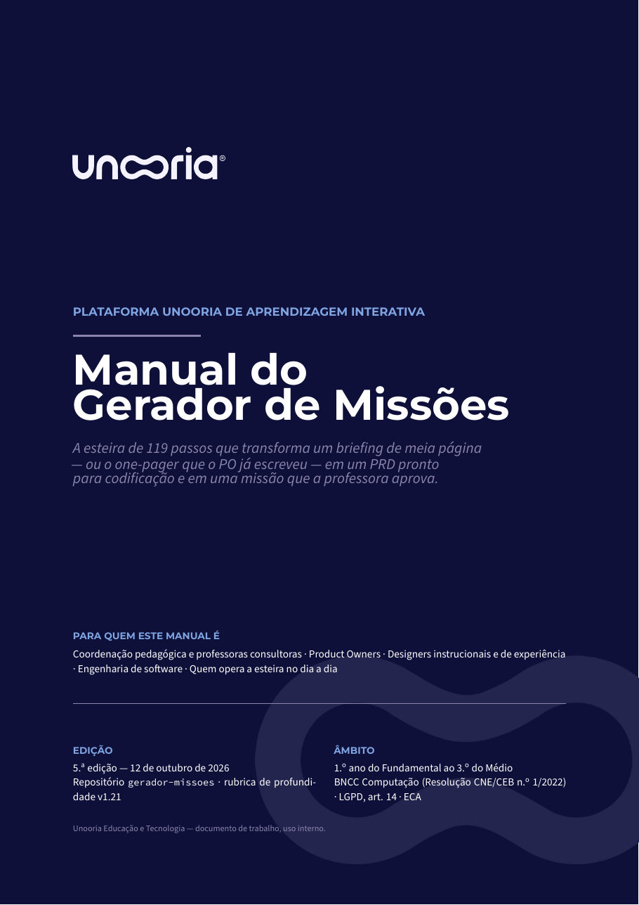
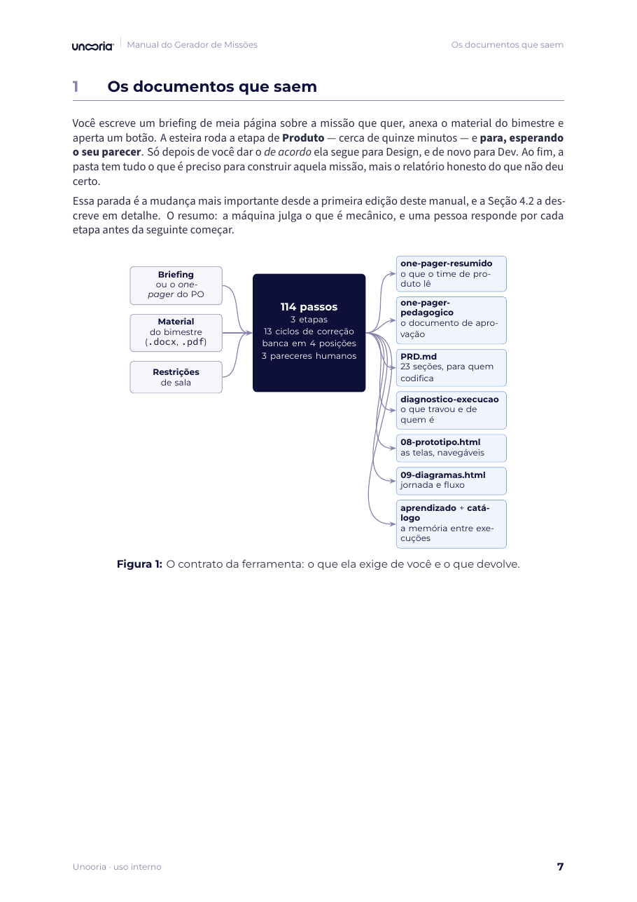
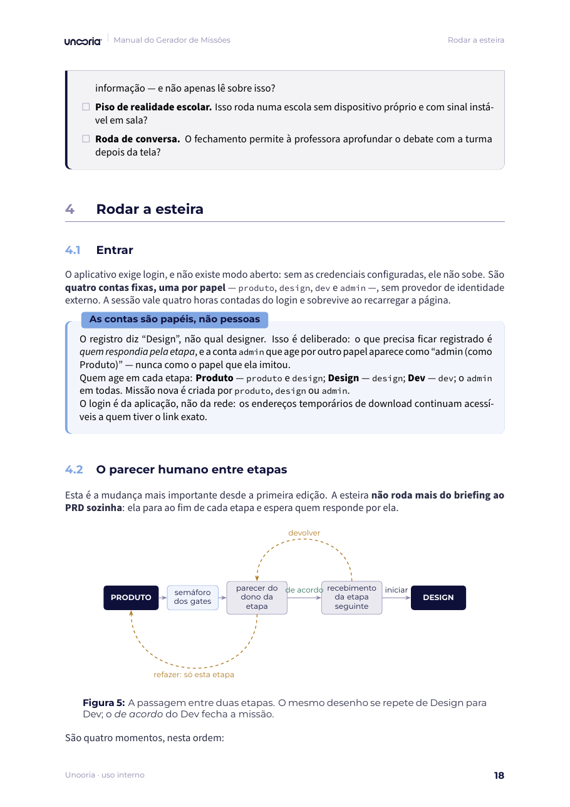
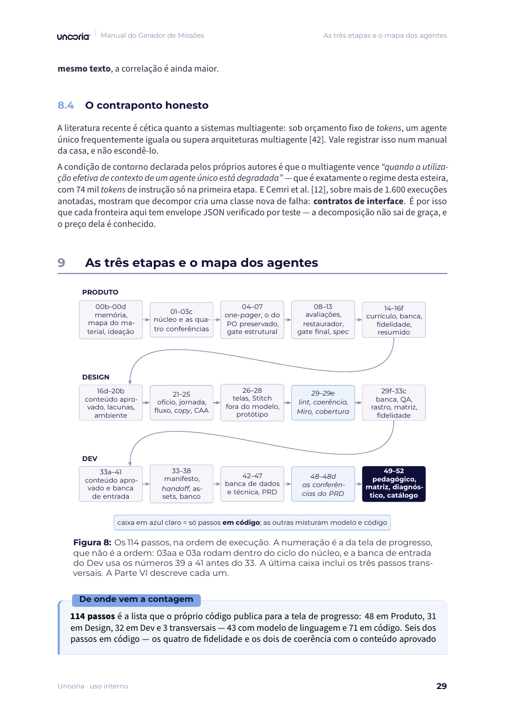
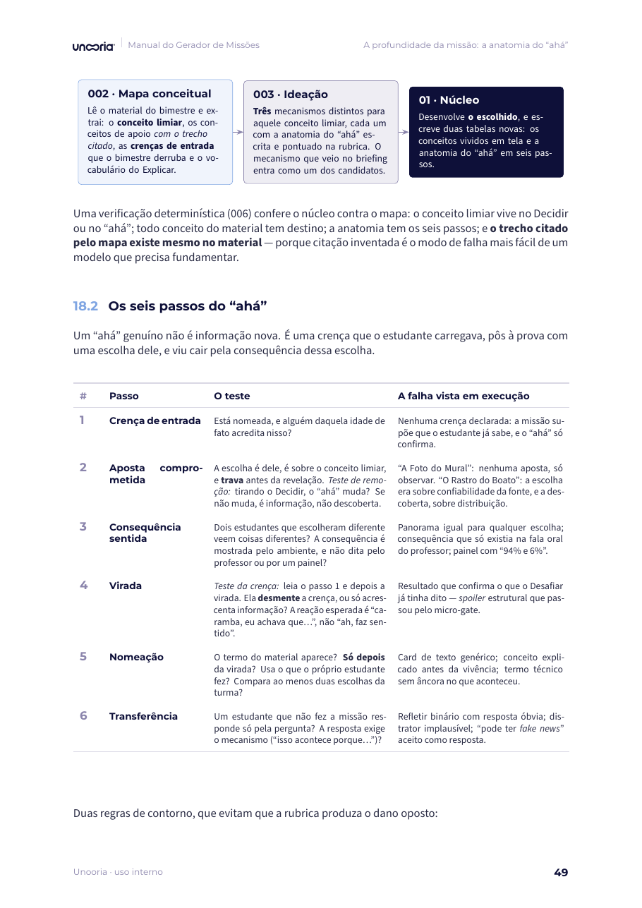
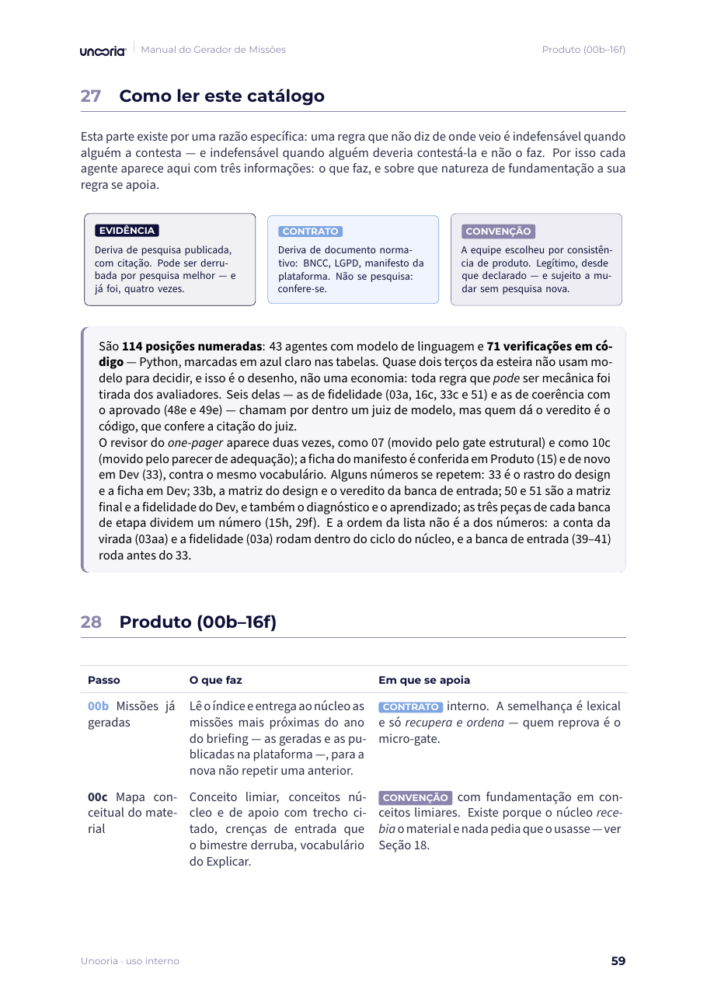
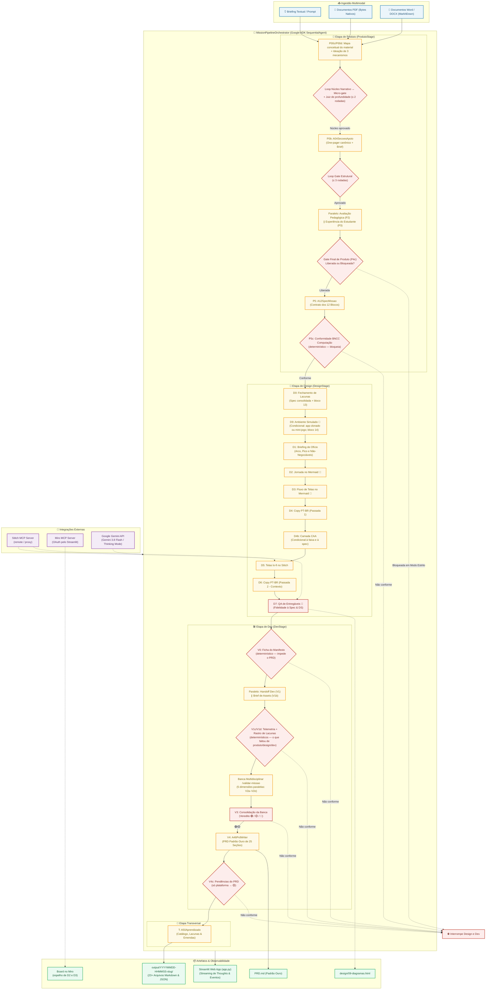
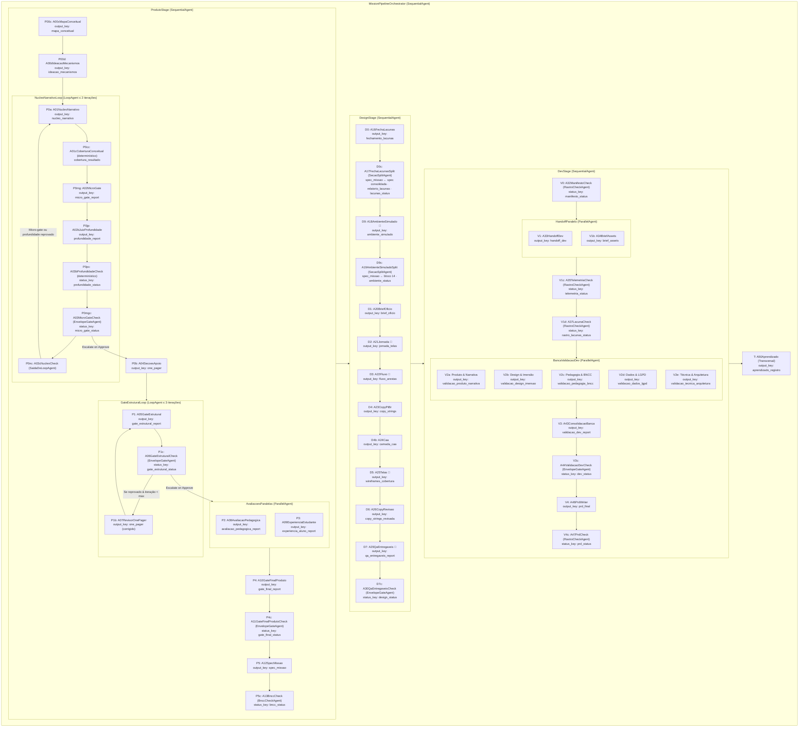
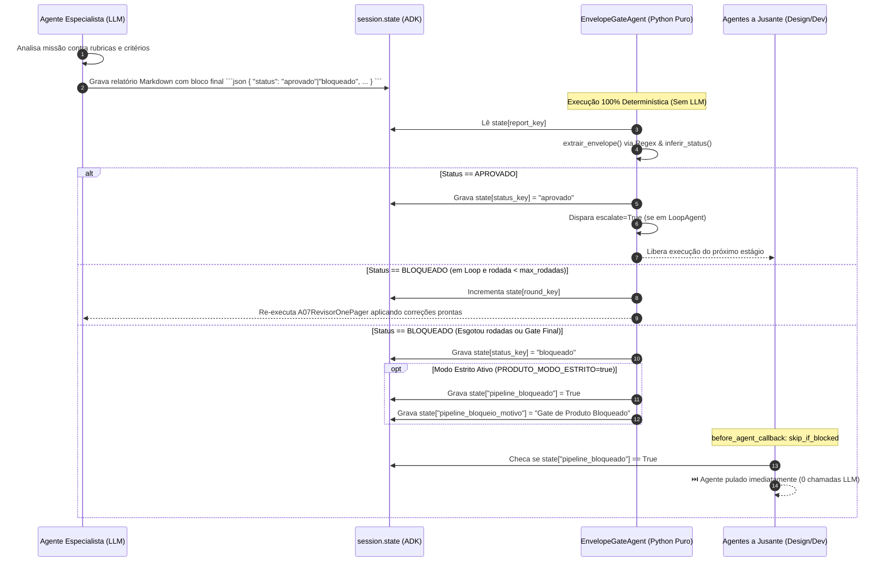

# 🌌 Gerador de Missões Unooria — Produto → Design → Dev


> 📘 **Manual do Gerador de Missões:** [`manual-unooria/manual-gerador-missoes.pdf`](manual-unooria/manual-gerador-missoes.pdf) — 68 páginas com identidade visual Unooria. É a documentação para **usar e entender** a esteira; este README é a referência técnica do repositório. Prévia das páginas logo abaixo, em [Manual](#-manual).
>
> O manual unifica e substitui os dois documentos anteriores — o [guia de funcionamento](documentacao-latex/guia-do-gerador-de-missoes.pdf) (operação) e o [manual completo e explicativo](manual-gerador-missoes/manual_gerador_missoes.pdf) (fundamentação), mantidos no repositório como histórico.

Pipeline multiagente de nível de produção construído com o **Google ADK (Agent Development Kit)** e modelos **Google Gemini** (com suporte a *Thinking Mode* nativo). O sistema traduz a ideia bruta ou o *one-pager* de uma missão de letramento digital em um **PRD (Product Requirements Document) padrão ouro com 25 seções**, complementado por especificações de design, jornada e fluxo em Mermaid (espelhados em board do Miro), telas no Stitch, protótipo HTML navegável e validação técnica por banca multidisciplinar, pronto para alimentar agentes de codificação no monorepo `plataforma-unooria`.

---

## 📑 Sumário

- [Manual](#-manual)
- [Visão Geral e Proposta de Valor](#-visão-geral-e-proposta-de-valor)
- [Diagramas de Arquitetura](#-diagramas-de-arquitetura)
  - [1. Macroarquitetura End-to-End](#1-macroarquitetura-end-to-end)
  - [2. Hierarquia de Agentes e Estado do ADK](#2-hierarquia-de-agentes-e-estado-do-adk)
  - [3. Ciclo de Gates e Controle Determinístico](#3-ciclo-de-gates-e-controle-determinístico)
- [Detalhamento das Áreas e Agentes](#-detalhamento-das-áreas-e-agentes)
  - [🧭 Área de Produto](#-área-de-produto)
  - [🎨 Área de Design & Integrações MCP](#-área-de-design--integrações-mcp)
  - [🛠️ Área de Dev & Banca de Validação](#-área-de-dev--banca-de-validação)
  - [🧠 Área Transversal de Aprendizado](#-área-transversal-de-aprendizado)
- [Controle de Fluxo Determinístico e Anti-Alucinação](#-controle-de-fluxo-determinístico-e-anti-alucinação)
- [Processamento Multimodal de Documentos](#-processamento-multimodal-de-documentos)
- [Integrações MCP (Model Context Protocol)](#-integrações-mcp-model-context-protocol)
- [Artefatos Gerados e o PRD Padrão Ouro](#-artefatos-gerados-e-o-prd-padrão-ouro)
- [Contexto da Plataforma Unooria](#-contexto-da-plataforma-unooria)
- [Interface Streamlit e Histórico de Sessões](#-interface-streamlit-e-histórico-de-sessões)
- [Configuração e Variáveis de Ambiente](#-configuração-e-variáveis-de-ambiente)
- [Guia Operacional: Instalação, Execução e Testes](#-guia-operacional-instalação-execução-e-testes)
- [Docker e Deploy no Cloud Run](#-docker-e-deploy-no-cloud-run)

---

## 📘 Manual

O manual único da esteira vive em [`manual-unooria/`](manual-unooria/): fonte LaTeX, assets de marca e o PDF.
Compila com `tectonic -X compile manual-gerador-missoes.tex`.

| | |
|---|---|
| 📄 **PDF** | [`manual-unooria/manual-gerador-missoes.pdf`](manual-unooria/manual-gerador-missoes.pdf) — 68 páginas, 2.ª edição (25/09/2026) |
| 📝 **Fonte** | [`manual-unooria/manual-gerador-missoes.tex`](manual-unooria/manual-gerador-missoes.tex) |
| 🎨 **Identidade** | Paleta e tipografia do *brandbook*, documentadas em [`manual-unooria/README.md`](manual-unooria/README.md) |

Sete partes, que não precisam ser lidas na ordem:

| Parte | Título | Responde a |
|:-:|---|---|
| I | O que a esteira faz | Que documentos saem, para quem, e o que significa a esteira não abortar. |
| II | Como usar | O que colocar no briefing, o **parecer humano entre etapas**, a conversa com as etapas, o modo correção e como ler o diagnóstico. |
| III | Como é construída | Por que 72 passos e não um prompt grande; portões, ciclos e o controle anti-alucinação. |
| IV | Por que funciona | A jornada de seis etapas, a **profundidade pedagógica** (a anatomia do *ahá*), a carga cognitiva e a régua por idade — com os números e as fontes. |
| V | O que protege | BNCC e o primado do letramento digital, LGPD art. 14, ética de acolhimento. |
| VI | Os agentes, um a um | O catálogo completo, com o que cada um faz e em que se apoia. |
| VII | O que a operação ensinou | As correções que só apareceram ao rodar a esteira inteira sobre material real. |

> Toda descrição de agente, portão, variável de ambiente e artefato no manual foi conferida contra o
> código deste repositório — `agents/`, `config.py`, `prompts/` — e não contra a documentação anterior.
> Ao mudar a esteira, o catálogo da Parte VI é o primeiro trecho a revisar.
>
> **2.ª edição (25/09/2026):** cobre o parecer humano entre etapas, o login por papel, a camada de
> profundidade pedagógica, a memória entre execuções, as perguntas de produto e o recorte da aula por
> disciplina. A 1.ª edição descrevia 55 passos e uma esteira que rodava sozinha do briefing ao PRD.

### Prévia

<table>
<tr>
<td width="33%"></td>
<td width="33%"></td>
<td width="33%"></td>
</tr>
<tr>
<td align="center"><sub><b>Capa</b></sub></td>
<td align="center"><sub><b>Parte I</b> — o que entra e o que sai</sub></td>
<td align="center"><sub><b>Parte II</b> — o parecer humano entre etapas</sub></td>
</tr>
<tr>
<td></td>
<td></td>
<td></td>
</tr>
<tr>
<td align="center"><sub><b>Parte III</b> — o mapa dos 72 passos</sub></td>
<td align="center"><sub><b>Parte IV</b> — a anatomia do <i>ahá</i></sub></td>
<td align="center"><sub><b>Parte VI</b> — o catálogo, agente a agente</sub></td>
</tr>
</table>

---

## 🚀 Visão Geral e Proposta de Valor

Criar uma missão educacional interativa de alta imersão para a plataforma Unooria exige alinhar **quatro domínios complexos**:
1. **Pedagogia & BNCC:** aderência à Base Nacional Comum Curricular, adequação à faixa etária (4º ao 9º ano EF), descoberta central autêntica, agência real do estudante e papel docente mediador com *checkpoints* flexíveis.
2. **Design de Experiência & Ofício:** simulação fiel de ambientes reais (Instagram, YouTube, TikTok, WhatsApp, ChatGPT), arco dramático, picos de tensão, inventário de telas e conformidade com o Design System `@unooria/design-system`.
3. **Engenharia de Software & Arquitetura:** modelo de dados em três camadas (Missão, Etapa, Desafio), contratos de API Zod/OpenAPI, protocolo de comunicação iframe via `postMessage`, telemetria operacional/analítica e conformidade estrita com o Art. 14 da LGPD (dados de menores).
4. **Viabilidade Técnica do Monorepo:** caminhos reais de código em Next.js 16, NestJS, Prisma/PostgreSQL, TypeScript e Docker.

O **Gerador de Missões** automatiza essa cadeia por meio de **72 passos numerados na ordem de execução** — 37 agentes com LLM e 35 verificações determinísticas —, com **oito ciclos de correção automática**, bifurcações paralelas de validação, *gates* determinísticos sem inferência de LLM e **parecer humano entre as etapas**. A esteira **não aborta** quando um portão reprova: segue até o fim, marca como `[PROVISÓRIO]` o que derivou da parte reprovada e fecha com um diagnóstico do que travou e de quem é cada conserto.

```
Briefing / Ideia (+ PDF / DOCX)
    │
    ▼
[ PRODUTO ] ──▶ [ DESIGN ] ──▶ [ DEV ] ──▶ [ APRENDIZADO ]
  One-pager       Briefing        Handoff       Catálogo
  Gate (Loop)     Jornada         Assets        Padrões
  Avaliações (∥)  Fluxo           Banca (5 ∥)   Lacunas
  Gate Final      Copy (1 e 2)    Consolidação
  Spec (12 bl.)   Wireframes      PRD Ouro (25s)
                  QA Entregáveis
```

---

## 📐 Diagramas de Arquitetura

### 1. Macroarquitetura End-to-End

O diagrama a seguir ilustra o ciclo de vida completo da informação, desde a ingestão multimodal até a geração final dos artefatos em disco e na interface gráfica:



---

### 2. Hierarquia de Agentes e Estado do ADK

No Google ADK, os agentes trocam dados exclusivamente por meio de chaves no dicionário `session.state`. O diagrama a seguir expõe a hierarquia de contenção e o fluxo de chaves de estado de ponta a ponta:



---

### 3. Ciclo de Gates e Controle Determinístico

Um dos maiores desafios em pipelines multiagente é a propagação de erros e alucinações. O Gerador de Missões resolve isso com **Gates Determinísticos BaseAgent**, que isolam a decisão lógica do modelo generativo:



---

## 🔍 Detalhamento das Áreas e Agentes

### 🧭 Área de Produto

A área de Produto garante que nenhuma missão siga para concepção visual ou codificação sem clareza pedagógica, consistência com as diretrizes da Unooria e logística de sala de aula viável.

| Agente | ID | Tipo / Container | Insumos (`session.state`) | Saída (`output_key`) | Responsabilidade Central |
|---|---|---|---|---|---|
| **Mapa conceitual do material** | `P00c` | `LlmAgent` (seed fixo) | `{material_anexado?}`, `{briefing?}` | `mapa_conceitual` | Lê o material do bimestre **antes** de inventar a missão: um conceito limiar (o que a virada precisa mudar no estudante), de dois a quatro conceitos núcleo e os de apoio, cada um com o trecho do material entre aspas; as crenças de entrada que o bimestre derruba; o vocabulário do Explicar; o teto de ambição. Nos anos iniciais escolhe a unidade pelo bimestre (o documento traz as quatro). Não copia código BNCC do material. |
| **Ideação de mecanismos** | `P00d` | `LlmAgent` | `{mapa_conceitual?}`, `{briefing?}`, `{material_anexado?}`, `{missoes_vizinhas?}` | `ideacao_mecanismos` | Três mecanismos que diferem na decisão **e** na virada, cada um com a anatomia do aha em seis passos, pontuados na rubrica de profundidade (`criterios-profundidade.md`). O núcleo desenvolve o escolhido. Mecanismo que veio no briefing é o candidato A e é preservado; B e C viram `[PROPOSTA — decisão do PO]`. |
| **Núcleo narrativo** | `P0a` | `LlmAgent` (Loop) | `user_message` (Prompt + PDFs/DOCX), `{mapa_conceitual?}`, `{ideacao_mecanismos?}`, `{micro_gate_report?}`, `{profundidade_report?}`, `{cobertura_report?}` | `nucleo_narrativo` | Escreve só as seções 0, 1, 3 e 4 — descoberta central, narrativa e as 6 etapas — para isolar o raciocínio criativo da formatação, e na seção 1 as tabelas **1.1** (conceitos do material vividos em tela) e **1.2** (anatomia do aha). É o **único** agente com `include_contents="default"` para receber os anexos originais. Reescreve o trecho apontado quando o micro-gate ou o juiz de profundidade reprovam. |
| **Cobertura conceitual** | `P0cc` | Determinístico (`CoberturaConceitualAgent`) | `nucleo_narrativo`, `mapa_conceitual`, `material_anexado` | `cobertura_report`, `cobertura_resultado` | `tools/profundidade.py`: o limiar do mapa vive no Decidir ou no Resultado/Aha; todo conceito núcleo tem etapa ou motivo para ficar de fora; a anatomia tem os seis passos; a citação do mapa existe no material (defeito do mapa é ⚠️, não bloqueio). |
| **Micro-gate do núcleo** | `P0mg` | `LlmAgent` (Loop) | `{nucleo_narrativo}` | `micro_gate_report` | Quatro verificações binárias: spoiler (4 padrões), gap de informação real, escolha significativa (4 testes) e job-to-be-done no Desafiar. Emite o envelope JSON com `passa`/`nao_passa`. |
| **Juiz de profundidade** | `P0jp` | `LlmAgent` (Loop, seed fixo) | `{nucleo_narrativo}`, `{mapa_conceitual?}`, `{material_anexado?}`, `{cobertura_report?}` | `profundidade_report` | Nota de 1 a 4 em seis dimensões — conceito do material vivido, aposta comprometida, ápice do aha, explicar depois de viver, transferência no Refletir, demanda à altura do ano —, cada uma com o trecho literal que a sustenta e a instrução de reescrita que a levaria a 4 **sem somar carga**. Aplica o teste da crença e o dos dois estudantes. |
| **Veredito de profundidade** | `P0pc` | Determinístico (`ProfundidadeCheckAgent`) | `profundidade_report`, `cobertura_resultado` | `profundidade_status` | Reconta o veredito nas notas, não no que o juiz escreveu: 🔴 com P1, P2 ou P3 abaixo de 3 ou qualquer dimensão em 1; 🟡 com P4–P6 em 2. Funde a cobertura. Não trava a esteira: o freio é o parecer humano, que recusa o *de acordo* de produto com este gate em 🔴. |
| **Veredito do micro-gate** | `P0mgc` | Determinístico | `{micro_gate_report}` | `micro_gate_status` | Registra se o núcleo passou em spoiler, gap, escolha e job. Teto de 2 rodadas; esgotado, segue com o achado registrado — quem bloqueia a missão é o gate estrutural. |
| **Saída do loop do núcleo** | `P0nc` | Determinístico (`SaidaDeLoopAgent`) | `micro_gate_status`, `profundidade_status` | `nucleo_rodada` | Encerra o loop só com micro-gate **e** profundidade aprovados; qualquer um reprovado devolve o núcleo ao P0a com os relatórios. |
| **Seções de apoio e brief** | `P0b` | `LlmAgent` | `{nucleo_narrativo}`, `{briefing?}` | `one_pager` | Completa o one-pager canônico (seções 2 e 5–18) sobre o núcleo aprovado, sem alterar as seções validadas, e entrega junto o brief de escopo para leitura rápida. Recebe o contrato de plataforma (`capacidades-plataforma.md`) e a regra de origem dos parâmetros: número que não vem do núcleo nem do briefing sai como `[PARÂMETRO — a definir por produto]`. |
| **Contrato de plataforma e origem dos parâmetros** | `P0c` | Determinístico (`RastroCheckAgent`, modo `one_pager`) | `one_pager`, `nucleo_narrativo`, `briefing` | `contrato_produto_report`, `contrato_produto_status` | Roda dentro do loop do gate, antes do P1, a cada rodada (`tools/contrato_produto.py`): ⛔ WebSocket/socket.io como canal de sala (a plataforma sincroniza por polling HTTP, ADR-93/94); ⚠️ progresso em `localStorage`/`IndexedDB` (estado é do servidor, 4.6); ⚠️ descritor SAEB fora de 2º/5º/9º EF e 3ª EM; ⚠️ número com unidade sem origem no núcleo/briefing e sem marcador; ⚠️ código de Computação fora de Cultura Digital sem etapa. Não bloqueia sozinho: o gate aplica cada achado no critério indicado e o revisor corrige. |
| **Gate estrutural** | `P1` | `LlmAgent` (Loop) | `{one_pager}` | `gate_estrutural_report` | Avalia **23 critérios** obrigatórios agrupados em: Estrutura, Ambiente simulado, Logística e tempo, Evidências e Fechamento de spec. Emite o envelope JSON. |
| **Veredito do gate estrutural** | `P1c` | `EnvelopeGateAgent` (Determinístico) | `gate_estrutural_report` | `gate_estrutural_status` | Analisa o envelope. Se aprovado, encerra o loop; se reprovado, aciona o revisor; se esgotar as 3 rodadas em modo estrito, bloqueia o pipeline. |
| **Revisor do one-pager** | `P1b` | `LlmAgent` (Loop) | `{one_pager}`, `{gate_estrutural_report}` | `one_pager` | Aplica as correções sugeridas no relatório do gate estrutural ("complemento pronto para colar"). **Nunca inventa decisões de negócio (marcadas como 🔵)**. |
| **Avaliação pedagógica** | `P2` | `LlmAgent` (Paralelo) | `{one_pager}` | `avaliacao_pedagogica_report` | Checa a descoberta central, o alinhamento à BNCC (habilidades de Língua Portuguesa e Computação), o papel docente mediador e a tensão *affordance × guardrail*. |
| **Experiência do aluno** | `P3` | `LlmAgent` (Paralelo) | `{one_pager}` | `experiencia_aluno_report` | Valida a adequação etária (cognitiva e motora), vocabulário, carga de leitura, agência e relevância cultural para o estudante. |
| **Gate final de produto** | `P4` | `LlmAgent` | `{one_pager}`, relatórios de P1, P2 e P3 | `gate_final_report` | Valida a coerência cruzada entre todos os pareceres anteriores. Emite o veredito definitivo: 🟢 LIBERADA ou 🔴 BLOQUEADA. |
| **Veredito final de produto** | `P4c` | `EnvelopeGateAgent` (Determinístico) | `gate_final_report` | `gate_final_status` | Registra a liberação ou bloqueio no estado global e sinaliza `skip_if_blocked` se modo estrito estiver ativo. |
| **Spec da missão** | `P5` | `LlmAgent` | `{one_pager}`, `{gate_final_report}` | `spec_missao` | Converte o one-pager aprovado no contrato técnico dos **12 blocos de construção**, contra o qual Design e Dev construirão. |
| **Conformidade BNCC Computação** | `P5c` | Determinístico (`BnccCheckAgent`) | `spec_missao` | `bncc_status`, `bncc_report` | Confere o bloco 11 contra `references/bncc-computacao.json` (transcrição do anexo oficial do MEC, 130 habilidades): todo código existe, é da série do bloco 0 (`EF0n` = ano n · `EF15` = 1º–5º · `EF69` = 6º–9º · `EM13` = qualquer série do Médio) e, no Fundamental, há pelo menos uma habilidade de **letramento digital** (Cultura Digital). No Médio o anexo não tem eixo: basta pelo menos uma habilidade `EM13`, e a marca de letramento é orientação. Não conforme → 🔴 e a esteira para; design e dev não rodam. |
| **Rastro de lacunas da spec** | `P5f` | Determinístico (`RastroCheckAgent`, `etapa=produto`) | `spec_missao` | `rastro_spec_status`, `rastro_spec_report` | Conta os marcadores de lacuna da spec, no loop dela: lacuna de **produto** ou de **input** volta para quem escreveu a spec; decisão do PO (homologar, ratificar) fica 🟡 no semáforo do parecer de produto; lacuna de design ou de dev fica para a etapa dela. Antes só o rastro de dev a lia, e dev não reescreve a spec. |
| **One-pager resumido** | `P6` | `LlmAgent` | `{one_pager}`, `{spec_missao?}`, `{bncc_report?}`, pareceres de P2/P3 e adequação, `{briefing?}` | `one_pager_resumido` | Condensa a missão no formato curto que o time de produto usa para avaliação pedagógica — ficha, ideia em prosa, componente curricular do bimestre, socioemocionais por etapa, tabela das 6 etapas, onde o professor atua, contrato de evidência ternário por habilidade (com frase-template) e takeaway. Copia códigos só do bloco 11 já conferido; não decide nada novo. Sai também em `.docx` e `.html`. |

---

### 🎨 Área de Design & Integrações MCP

A área de Design recebe a `spec_missao` e a transforma em especificações de interface e jornada: diagramas em Mermaid, telas no Stitch e um protótipo HTML navegável. Com o Miro conectado, a jornada e o fluxo ganham também um board espelho.

Antes de qualquer construção, dois agentes preparam a spec: o **D0** fecha as lacunas que a esteira redescobriria seis vezes (decisões `[D0-n]` com base declarada, pedidos de re-spec `[RS-n]` ao Gate 0) e o **D9** decide o ambiente simulado quando a spec cala (app clonado da lista fechada, app novo ou, em 1º–5º ano, mini-jogo). Cada um emite a spec consolidada dentro do próprio relatório; um `SecaoSplitAgent` determinístico copia essa seção para `spec_missao` (a original do Gate 0 fica em `spec_missao_gate0`), de modo que D1–D7 leem a spec com os blocos 13 e 14 sem saber que D0/D9 existiram. Os status `lacunas_status` e `ambiente_status` são informativos: não há loop de re-spec com o Gate 0 na esteira, então `aguarda_gate` aparece como 🔴 na UI e o pipeline segue com os `RS-n` carimbados como pendentes.

| Agente | ID | Ferramentas | Saída (`output_key`) | Responsabilidade Central |
|---|---|---|---|---|
| **Fechamento de lacunas** | `D0` | — | `fechamento_lacunas` | Varre a spec contra `references/celulas-consumidas.md`, classifica cada lacuna (verde · amarelo · vermelho) e preenche só ausências deriváveis da missão (padrões de `references/defaults-missao.md`, catálogo, one-pager). Emite a spec consolidada com o **bloco 13** e um relatório de preenchimento em PT-BR para a PM e a professora. |
| **Spec consolidada + relatório** | `D0c` | Determinístico | `relatorio_lacunas` (+ `spec_missao`, `spec_missao_gate0`, `lacunas_status`) | Copia a seção "Spec consolidada" do D0 para `spec_missao`, separa o relatório de preenchimento e lê o envelope. |
| **Ambiente simulado** | `D9` | — | `ambiente_simulado` | Condicional: dormente quando a spec já nomeia um ambiente com seção no DS (mesmo assim emite a ficha do **bloco 14**: verbos com rótulo literal, chrome, estados, o que a plataforma real não tem). Quando decide, testa os cinco ambientes, aplica o gate de mini-jogo (1º–5º) e, se cria ambiente novo, monta a seção no arquivo do DS só com tokens existentes. |
| **Spec com bloco 14** | `D9c` | Determinístico | `ambiente_status` (+ `spec_missao`) | Copia a spec com o bloco 14 para `spec_missao` e lê o envelope (`dormente` · `existente` · `novo` · `aguarda_gate`). |
| **Briefing de ofício** | `D1` | — | `brief_oficio` | Extrai o arco dramático da missão: gancho inicial, pico de engajamento, beat memorável de ofício e não-negociáveis de imersão. |
| **Jornada no Mermaid** | `D2` | — | `jornada_telas` | Constrói a matriz de jornada (Raias × 6 Etapas), define cenários por dispositivo, inventário completo de telas e direção de arte por tela. |
| **Fluxo de telas no Mermaid** | `D3` | — | `fluxo_arestas` | Modela o grafo de estados e transições de tela com condições, gates de validação e execução dos **5 testes de fluxo** (caminho feliz, erro, desistência, recálculo e retorno). |
| **Copy PT-BR (Passada 1)** | `D4` | — | `copy_strings` | Redige todas as strings e microtextos da interface organizados por identificador de tela, calibrados para a linguagem da faixa etária. |
| **Camada CAA** | `D4b` | — | `camada_caa` | Comunicação aumentativa e alternativa: aplica um gate de aplicabilidade (faixa 1º–2º ano, ou spec/briefing que citem pré-leitores, CAA ou PEI) e, quando roda, define símbolo por conceito, modo de resposta alternativo por decisão, pranchas nos escapes e restrições de toque para o wireframe. Fora dessas condições devolve `nao_aplicavel`. |
| **Wireframes lo-fi no Stitch** | `D5` | `STITCH_TOOLS` | `wireframes_cobertura` | Monta os wireframes em escala de cinza sobre os componentes do Design System do ambiente simulado (`@unooria/design-system`). |
| **Copy PT-BR (Passada 2)** | `D6` | — | `copy_strings_revisada` | Revisa cada texto inserido no contexto da tela montada, ajustando densidade, quebras de linha e tom de voz. |
| **Espelho no Miro** | `D7b` | Determinístico | `miro_links` | Publica no Miro, como board navegável, os mesmos diagramas Mermaid de D2 e D3, e grava o link em `design/11-miro-boards.md`. Reusa o board entre as rodadas de retrabalho. Miro fora do ar não interrompe a etapa. |
| **QA de entregáveis** | `D7` | `STITCH_TOOLS` | `qa_entregaveis_report` | Auditoria rigorosa de conformidade contra a spec original, diff de strings, respeito ao Design System e critérios de ofício O1–O5. |
| **Veredito de design** | `D7c` | Determinístico | `design_status` | Lê o envelope do QA de design. Com `ESTEIRA_ESTRITA=true`, 🔴 impede dev e PRD; ressalvas entram no PRD. |
| **Rastro de lacunas do design** | `D7d` | Determinístico (`RastroCheckAgent`, `etapa=design`) | `rastro_design_status`, `rastro_design_report` | Lacuna de **design** na spec consolidada e nos documentos de design bloqueia a etapa, onde o designer ainda refaz. O que o fechamento de lacunas fechou (` — Resolvido em [D0-n]`, com o `[D0-n]` no bloco 13) não conta; lacuna de produto já aprovado e de dev ficam 🟡. |

---

### 🛠️ Área de Dev & Banca de Validação

**Dois entregáveis, dois leitores.** O `PRD.md` é para o agente de codificação: caminhos de arquivo, contratos, tarefas ordenadas. O `one-pager-pedagogico.docx` é para o time pedagógico aprovar a missão **antes** de alguém codificar, e por isso não tem uma linha de jargão. Os dois saem da mesma execução e contam a mesma missão para públicos que não se misturam.

**Os três one-pagers saem com a identidade visual da Unooria.** O de produto, o resumido e o pedagógico são os documentos que circulam fora do time — a PM encaminha o primeiro, o time de produto avalia a missão pelo segundo, a professora aprova o terceiro —, então cada um sai também em `.docx` e em `.html`, com capa navy, logotipo, títulos em azul profundo com régua lavanda e tabelas com as cores da marca. O `.docx` abre no Word e no Google Docs para comentar e editar, com as seções como `Heading` (navegação e sumário prontos) e os links do protótipo clicáveis; o `.html` abre no navegador e vira PDF pelo "Imprimir → Salvar como PDF", com logotipo embutido, sem depender de rede nem de LaTeX. A paleta, a tipografia e os logotipos ficam em [`tools/marca.py`](tools/marca.py), na mesma fonte da verdade do manual em LaTeX; a leitura do Markdown, em [`tools/markdown_blocos.py`](tools/markdown_blocos.py). O Markdown continua salvo do lado, porque é dele que os três saem.

**A missão pede, a plataforma cresce.** Tocar áudio e vídeo já é nativo no iframe. Gravar voz, usar câmera, gravar vídeo ou tela e pedir localização são capacidades que a plataforma ainda não concede, e por isso **não barram a missão**: a spec declara o que a mecânica precisa, o gate marca como pré-requisito de plataforma, e o PRD sai `aprovado-com-pendencias-de-plataforma` (🟡) com a tabela de implementação, o componente de design system a criar, a ADR necessária e a degradação sem o recurso. A tabela das três categorias, com o caminho de cada extensão, está em [`references/capacidades-plataforma.md`](prompts/references/capacidades-plataforma.md). Capturar mídia de criança cobra também o contrato de dados no bloco 9 da spec: onde fica, quanto tempo, quem lê. Decisão contrária já registrada, como WebSocket em vez de polling, continua bloqueando, porque a alternativa existe.

**Design sem Figma: Google Stitch, Miro e artefatos próprios.** O Figma exigia assento Full e OAuth para escrever no arquivo, e o cliente de comunidade que estava configurado só lia — board que ninguém consegue gerar não é entregável. As telas passaram a sair no **Google Stitch**, pelo endpoint MCP oficial do Google, autenticado por chave de API; a jornada e o fluxo saem em **Mermaid** e são espelhados num board do **Miro**. O agente de wireframes cria o projeto, ensina a ele a escala de cinza do lo-fi por `DESIGN.md`, gera uma tela por estado declarado e reporta o identificador do projeto. Um passo determinístico colhe os links das telas, separa o HTML do protótipo do relatório que o acompanha e monta a folha de diagramas a partir do Mermaid que a jornada e o fluxo já escreveram. Saem cinco artefatos por execução: o protótipo navegável, a folha de diagramas, a tabela de telas com o link do projeto, a folha do board no Miro e o relatório. O projeto no Stitch nasce privado, e o compartilhamento com outras pessoas é concedido na interface dele; a imagem de cada tela tem endereço público e serve de prévia enquanto isso.

**A experiência é um iframe no hub desktop.** O protótipo desenha a casca de aparelho centralizada numa página desktop quando o manifesto declara `viewport`, e a janela cheia quando não declara. Telas de professor e de projeção são sempre desktop. É a diferença entre o protótipo mostrar o que a criança vê num Chromebook e mostrar um celular que não existe.

**Schema de servidor MCP chega quebrado, e o erro aparece longe da causa.** O Stitch publica referências para definições que ele mesmo omite, e o ADK repassa esse schema ao Gemini, que recusa a requisição inteira com um 400 sobre "undefined schema". Pior: o erro estoura no agente que estava no ar quando a lista de ferramentas foi montada, que pode nem usar a ferramenta. [`tools/mcp_saneado.py`](tools/mcp_saneado.py) sanea antes de o schema chegar ao modelo: descarta o schema de resposta, que o modelo não usa para chamar a ferramenta e que ainda carrega enums de centenas de valores, e remenda as referências órfãs no schema de entrada, onde elas são necessárias. Vale para qualquer toolset MCP que a esteira venha a montar.

**Contenção do que as ferramentas devolvem.** As respostas das ferramentas MCP entram no mesmo turno do agente, e `include_contents="none"` não as descarta: um agente que monta telas acumula dezenas de respostas de escrita, o dump do arquivo e a captura até o modelo recusar a requisição. Foi assim que a jornada estourou o teto de um milhão de tokens com um prompt de 22 KB. Todo agente com ferramentas nasce com dois limitadores em [`agents/callbacks.py`](agents/callbacks.py): a resposta é podada antes de voltar ao modelo (captura de tela sai do contexto, texto longo é truncado) e cada agente tem orçamento acumulado; esgotado, as chamadas seguintes são recusadas com a instrução de entregar o documento com o que já construiu. Vale mais o markdown com o board pela metade do que a execução inteira morrendo.

**Contexto da plataforma pela base publicada no bucket.** Os agentes não leem resumos escritos à mão: leem cópias dos `AGENTS.md`, das regras (`docs/regras/*`), dos ADRs e dos contratos Zod do monorepo `plataforma-unooria`, mais o **contrato da plataforma** (seções do DS, campos do manifesto, portas, última ADR, equipes, evidência), extraído do código. Quem publica é quem conhece: o CI da plataforma grava `gs://entre-redes-dev-adk-artifacts/base-plataforma/plataforma/<commit>/` a cada push em `dev-local`, e o do storybook grava `base-plataforma/design-system/<versao>/` a cada versão publicada; cada um troca o próprio `atual.json` por último. O Cloud Run do gerador já monta esse bucket em `/app/output`, e cada execução fixa a base que leu no começo (`prompts/base_plataforma.py`) e a registra no cabeçalho do diagnóstico. Até 06/10/2026 isso era uma cópia no git, que ficou 320 commits atrás sem ninguém ver. Para rodar localmente: `gcloud storage rsync -r gs://entre-redes-dev-adk-artifacts/base-plataforma output/base-plataforma` (ou `BASE_PLATAFORMA_DIR` apontando para uma base gerada com `node scripts/base-do-gerador/extrair.mjs --saida` na plataforma e `node scripts/inventario-para-o-gerador.mjs --saida` no storybook). Os arquivos `plataforma-unooria-software.md`, `-infra.md` e `-design-system.md` viraram índices sobre essas cópias, com a lista do que mais muda num PRD (liberação por turma, `produto`/`unidade` no manifesto, seis papéis, evento `verbo · objeto · resultado · contexto`, cinco caminhos de dado, sala por polling, currículo no servidor, quota em `ia_quotas`, fuso único, fluxo `dev-local → dev → hml → main`). O `_template` da plataforma passou a trazer a fiação completa em 16/09/2026 (ADR-106), então o PRD diz o que trocar primeiro, não o que falta.

A etapa de Dev materializa o handoff para a equipe de tecnologia e submete a missão a uma **banca multidisciplinar com 72 critérios de validação (21 bloqueantes)** antes de lavrar o PRD padrão ouro.

```
                    ┌─ A33HandoffDev (V1)
                    │  A34BriefAssets (V1b)
                    │
                    ▼
┌───────────────────────────────────────────────────────────┐
│     Banca de Validação Multidisciplinar (5 em paralelo)   │
│                                                           │
│  [V2a] Produto & Narrativa  ──────▶ PROD-01 … 16 (4 bloq) │
│  [V2b] Design & Imersão     ──────▶ DES-01 … 13  (4 bloq) │
│  [V2c] Pedagogia & BNCC     ──────▶ PED-01 … 15  (5 bloq) │
│  [V2d] Dados & LGPD         ──────▶ DAD-01 … 15  (4 bloq) │
│  [V2e] Técnica & Monorepo   ──────▶ TEC-01 … 13  (4 bloq) │
└───────────────────────────────────────────────────────────┘
                    │
                    ▼
         A43ConsolidacaoBanca (V3)
         Veredito: 🟢 APTO | 🟡 APTO C/ RESSALVAS | 🔴 NÃO APTO
                    │
                    ▼
         A46PrdWriter (V4) ──▶ PRD.md (25 Seções)
```

| Agente | ID | Critérios / Rubrica | Saída (`output_key`) | Descrição |
|---|---|---|---|---|
| **Ficha do manifesto** | `V0` | Determinístico (`RastroCheckAgent`) | `manifesto_status`, `manifesto_report` | Lê a ficha do bloco 0 da spec e confere cada campo contra as listas fechadas da plataforma (`produto`, `series`, `unidade`, `publico`, `viewport`, `permissoes`, `capabilities`, `secao_ds`, `liberacao: por-turma`). Campo ausente ou inválido impede o PRD. **Capacidade que a plataforma ainda não concede** (gravar voz, câmera, vídeo, localização) **não impede**: vira pré-requisito de plataforma e o PRD sai 🟡 com o caminho de implementação. `tiktooria` e seção de DS nova seguem a mesma regra. |
| **Handoff para dev** | `V1` | Modelo de Insumo | `handoff_dev` | Preenche o modelo de insumo com User Stories fechadas (com travas 🔒), catálogo de eventos de telemetria e escopo V1 vs V2. |
| **Brief de assets** | `V1b` | Rubrica de Assets | `brief_assets` | Inventário completo de produção: imagens, áudios, mockups, critérios de reprovação e ordem de criação. |
| **Telemetria e arquitetura** | `V1c` | Determinístico | `telemetria_status`, `telemetria_report` | Confere no handoff o contrato real de evento (`verbo · objeto · resultado · contexto`, sem campo `dados`), tabela `expNNefNb_*` de leitura das medidas, ausência de WebSocket/`hub:pause` (ADR-93/94), seis papéis (ADR-80) e quota em `ia_quotas` (ADR-105). |
| **Rastro de lacunas** | `V1d` | Determinístico | `rastro_lacunas_status`, `rastro_lacunas_report` | Conta os marcadores `[LACUNA — dono]`, `[ABERTO — dono]`, `[NEEDS CLARIFICATION]`, `[verificar no repositório]`, `RS-n pendente` e `🔵` em spec, design, handoff e assets, e diz **o que faltou de input, produto, design ou dev**. Com `etapa=dev`, só lacuna de **dev** — ou uma de etapa anterior escrita pelo próprio handoff ou brief — impede o PRD; a de produto ou de design num documento delas já foi cobrada no rastro da etapa dona e fica 🟡, «de etapa anterior». Lacuna cuja dona é a **plataforma** (ADR nova, componente de DS, ponte) vira pendência humana e deixa o PRD 🟡. |
| **Banca: Produto & Narrativa** | `V2a` | `PROD-01` a `16` (4 bloqueantes) | `validacao_produto_narrativa` | Avalia clareza do problema, coerência narrativa, loop de engajamento e métricas de sucesso. |
| **Banca: Design & Imersão** | `V2b` | `DES-01` a `13` (4 bloqueantes) | `validacao_design_imersao` | Avalia fidelidade ao ambiente simulado, consistência de layout e acessibilidade visual. |
| **Banca: Pedagogia & BNCC** | `V2c` | `PED-01` a `15` (5 bloqueantes) | `validacao_pedagogia_bncc` | Avalia alinhamento rigoroso à BNCC, profundidade conceitual e rubricas de avaliação formativa. |
| **Banca: Dados & LGPD** | `V2d` | `DAD-01` a `15` (4 bloqueantes) | `validacao_dados_lgpd` | Avalia telemetria analítica (xAPI), proteção de dados de menores (LGPD Art. 14) e retenção. |
| **Banca: Técnica & Arquitetura** | `V2e` | `TEC-01` a `13` (4 bloqueantes) | `validacao_tecnica_arquitetura` | Avalia compatibilidade com o monorepo NestJS/Next.js 16, performance e contratos de API. |
| **Consolidação da banca** | `V3` | Matriz de Decisão | `validacao_dev_report` | Consolida os relatórios em veredito único determinístico (🟢 / 🟡 / 🔴). |
| **Veredito de dev** | `V3c` | Determinístico | `dev_status` | Lê o veredito da banca. Com `ESTEIRA_ESTRITA=true`, 🔴 impede o PRD e a consolidação diz o que falta e quem resolve (PO, Designer, produto ou decisão de plataforma); 🟡 segue. |
| **Redator do PRD** | `V4` | Gabarito de 25 seções | `prd_final` | **O grande entregável do pipeline**: PRD completo com contexto arquitetural real da plataforma Unooria. |
| **One-pager pedagógico** | `V5` | — | `one_pager_pedagogico` | **O entregável para gente.** A missão inteira em linguagem de sala de aula: o que a criança faz e descobre, as seis etapas contadas como história, o que a professora faz antes, durante e depois com as perguntas da roda escritas para ler em voz alta, os links do protótipo e das telas, o que a missão não faz de propósito, o que pode dar errado na sala, e de três a seis perguntas objetivas que só o time pedagógico responde. Proibido jargão: o prompt carrega uma tabela do que não se escreve e do que se escreve no lugar. Salvo em Markdown e, com a identidade visual da Unooria, em **`.docx`** e **`.html`** (este imprime em PDF). |
| **Pendências do PRD** | `V4c` | Determinístico | `prd_status`, `prd_check_report` | Conta os marcadores que o redator deixou no PRD. Lacuna de produto/design/dev marca o PRD como não pronto; só pendência de plataforma deixa 🟡 (`aprovado-com-pendencias-de-plataforma`). |

---

### 🧠 Área Transversal de Aprendizado

- **Agente de Aprendizado (`A50Aprendizado` / `T`):**
  - Roda ao final de toda execução (mesmo que haja bloqueios ou ressalvas).
  - Atualiza o registro em `output/<execucao>/aprendizado.md`.
  - Extrai:
    1. **Linha do Catálogo de Missões:** metadados normalizados da missão para o catálogo geral.
    2. **Padrões de Sucesso:** soluções criativas encontradas para conciliar BNCC e mecânica de jogo.
    3. **Lacunas por Classe:** problemas reincidentes com identificação de causa-raiz.
    4. **Candidatos a Critério:** propostas formais de novos critérios de gate para as referências do repositório.
  - *Regra de ouro:* O agente de aprendizado **nunca altera diretamente os prompts dos agentes**; ele escreve propostas estruturadas para revisão humana.

---

## 🛡️ Controle de Fluxo Determinístico e Anti-Alucinação

Para garantir que o pipeline funcione como uma esteira industrial confiável, adotamos regras estritas de engenharia de contexto no ADK:

1. **Isolamento Total de Contexto (`include_contents="none"`):**
   - No Google ADK, agentes configurados com `include_contents="default"` herdam o histórico completo de conversação do runner, gerando poluição contextual e alucinações cumulativas.
   - No Gerador de Missões, **todos os agentes (exceto P0a) operam com `include_contents="none"`**. Eles recebem única e exclusivamente os dados necessários explicitamente interpolados em seu prompt de sistema através das variáveis `{chave}` do `session.state`.
2. **Interpolação Segura com Fallback (`{chave?}`):**
   - Variáveis com `{chave}` estrita falham imediatamente se a chave não existir no estado.
   - Variáveis marcadas com `{chave?}` degradam graciosamente se a etapa correspondente não tiver sido executada (ex.: rodar diretamente a etapa de Dev).
3. **Contrato de Envelope JSON:**
   - Todo relatório de gate encerra obrigatoriamente com o envelope JSON padronizado:
     ```json
     ```json
     {
       "status": "aprovado | bloqueado | apto_com_ressalvas",
       "veredito": "🟢 LIBERADA PARA DESIGN/DEV",
       "criterios_reprovados": [],
       "bloqueios": []
     }
     ```
     ```
4. **Decisões de Produto Protegidas (🔵):**
   - Decisões estratégicas de produto que dependem de premissas de negócio não fornecidas no briefing são categorizadas com a tag `[DECISÃO PENDENTE — responsável de produto]`. Os agentes são proibidos de inventar tais decisões.

---

## 📄 Processamento Multimodal de Documentos

O módulo [`tools/doc_parser.py`](file:///Users/lucassalomao/Documents/Unooria/gerador-missoes/tools/doc_parser.py) processa documentos anexados pelo usuário com alto desempenho:

- **PDFs Nativos:** Injetados diretamente em formato binário como partes `types.Part.from_bytes(data, mime_type="application/pdf")`, aproveitando a capacidade multimodal nativa do Gemini para interpretação de diagramas, tabelas e layouts visuais. O texto também é extraído (`markitdown[pdf]`) para os caminhos que só leem texto, como o modo correção.
- **Word (DOCX/DOC):** Convertidos para Markdown estruturado via **Microsoft MarkItDown**, preservando tabelas, listas e títulos sem perda semântica.
- **Markdown e texto (`.md`, `.markdown`, `.txt`):** entram como estão (UTF-8, com fallback Latin-1), inline na mensagem.
- **Limites de Segurança:** Validação estrita de lote: máximo de **60 arquivos** e limite agregado de **25 MB**.

---

## 🔌 Integrações MCP (Model Context Protocol)

Dois servidores MCP, com papéis distintos. O **Stitch** gera as telas; o **Miro** espelha os diagramas. O MCP do Figma saiu da esteira: não há cliente oficial que o sirva neste ambiente, e board que ninguém consegue gerar não é entregável.

Nenhuma das duas integrações é caminho crítico. Fora do ar, cada uma registra a própria indisponibilidade no artefato e a esteira entrega a missão assim mesmo — porque o que vale é sempre o texto versionado: a especificação de telas em Markdown, e o Mermaid da jornada e do fluxo.

### 🎨 Stitch — as telas (D5 e D7)

O módulo [`tools/stitch_mcp.py`](tools/stitch_mcp.py) entrega o toolset aos agentes de wireframe e de QA. Aqui o modelo **usa ferramentas**: é ele que decide quais telas gerar.

| Modo | Transporte | Quando usar |
|---|---|---|
| `remote` | `stitch.googleapis.com/mcp` com `X-Goog-Api-Key` | Padrão quando há `STITCH_API_KEY`. |
| `proxy` | `npx @_davideast/stitch-mcp` | Quando o schema do servidor precisa de saneamento. |
| `off` | — | Sem chave: a esteira segue e registra `STITCH: indisponível`. |

### 🪞 Miro — o espelho dos diagramas (D2 e D3)

A jornada e o fluxo saem em **Mermaid**, e é o Mermaid que entra no PRD, nos gates e no `design/09-diagramas.html`. Depois da etapa, um passo determinístico publica esse mesmo bloco como board navegável e grava o link em `design/11-miro-boards.md`. **O board é espelho, nunca fonte**: editá-lo não altera a missão, e a ausência dele não é achado de QA.

Aqui o modelo **não** usa ferramenta nenhuma. Quem publica é [`tools/miro_cliente.py`](tools/miro_cliente.py), chamando o MCP por JSON-RPC fora do turno do agente. O motivo é concreto: deixar um LLM construir board item a item foi o que estourou o teto de contexto no D2 quando os diagramas viviam no FigJam. O espelho aproveita que `canvas_create_from_svg` aceita Mermaid nativo dentro de um `<foreignObject data-type="diagram">` — então não há parser, nem layout a manter.

**Autenticação, e por que ela é diferente de tudo o mais aqui.** `https://mcp.miro.com/` é o seu próprio authorization server: publica `/authorize`, `/token` e `/register`, e só aceita clients que ele mesmo emitiu por registro dinâmico (RFC 7591). O `client_id` de um app criado no dev portal do Miro é **recusado**. Não há, portanto, "cole a chave no `.env`": [`tools/miro_oauth.py`](tools/miro_oauth.py) registra o client, conduz o authorization code com PKCE pelo navegador e guarda os tokens em `.miro_mcp_tokens.json`, renovando sozinho. O fluxo começa no botão **🔗 Conectar ao Miro**, no card de integrações da barra lateral.

Dois detalhes que custam caro quando esquecidos:

- O `MIRO_REDIRECT_URI` precisa bater com o endereço em que o Streamlit atende, e a autorização acontece **na mesma aba** — o PKCE fica em disco justamente porque ir ao Miro e voltar abre uma sessão nova do Streamlit.
- O Miro **rotaciona o refresh token** a cada renovação: dois processos com o mesmo arquivo de tokens se invalidam mutuamente. No Cloud Run, onde o disco é efêmero e a conexão se perderia a cada deploy, o padrão do `.env.yaml` é `MIRO_MODE: "off"`.

| Modo | Transporte | Quando usar |
|---|---|---|
| `remote` | `mcp.miro.com` com OAuth 2.1 + registro dinâmico | Padrão local (`auto` resolve para cá). |
| `off` | — | Deploy, CI e testes: a folha sai com `MIRO: indisponível` e a esteira segue. |

## 📦 Artefatos Gerados e o PRD Padrão Ouro

Toda execução bem-sucedida persiste uma árvore de entregáveis isolada em `output/<data-hora>-<slug-da-missao>/`:

```
output/20260904-143000-exp-04-fake-news/
├── PRD.md                             # 📘 O PRD Padrão Ouro (25 seções)
├── aprendizado.md                     # 🧠 Registro de aprendizado e catálogo
├── briefing-original.md               # 💡 Insumo original enviado pelo usuário
├── estado.json                        # 🔍 Estado completo serializado (session.state)
├── manifesto-artefatos.json           # 📋 Metadados de todos os arquivos gerados
├── produto/
│   ├── 00g-mapa-conceitual.md         # Conceito limiar, núcleos e crenças do material do bimestre
│   ├── 00h-ideacao-mecanismos.md      # Três mecanismos pontuados e o escolhido
│   ├── 00a-nucleo-narrativo.md        # Seções 0, 1 (com 1.1 e 1.2), 3 e 4 (núcleo criativo)
│   ├── 00i-cobertura-conceitual.md    # Núcleo × mapa: limiar no aha, núcleos com destino, anatomia completa
│   ├── 00b-micro-gate.md              # Spoiler, gap, escolha e job-to-be-done
│   ├── 00j-juiz-profundidade.md       # Notas P1–P6, teste da crença e instruções de reescrita
│   ├── 00-one-pager.md                # One-pager canônico + brief de escopo
│   ├── 00-one-pager.docx              # o mesmo, com a identidade visual, para editar
│   ├── 00-one-pager.html              # o mesmo, para apresentar e imprimir em PDF
│   ├── 00e-contrato-produto.md        # P0c: lint do one-pager — canal de sala, estado no servidor, SAEB, números sem origem
│   ├── 01-gate-estrutural.md          # Relatório de 23 critérios e envelope
│   ├── 02-avaliacao-pedagogica.md     # Parecer BNCC e mediação docente
│   ├── 03-experiencia-aluno.md        # Parecer de adequação etária e agência
│   ├── 04-gate-final.md               # Liberação formal de produto
│   ├── 05-spec-missao.md              # Contrato de construção (12 blocos + 13 do D0 + 14 do D9)
│   ├── 05a-spec-missao-gate0.md       # Cópia da spec original do Gate 0 (antes do D0)
│   ├── 05b-conformidade-bncc.md       # P5c: bloco 11 × lista oficial da BNCC Computação
│   ├── 00d-one-pager-resumido.md      # P6: o formato curto do time de produto para avaliação pedagógica
│   ├── 00d-one-pager-resumido.docx    # o mesmo, com a identidade visual, para editar
│   └── 00d-one-pager-resumido.html    # o mesmo, para apresentar e imprimir em PDF
├── design/
│   ├── 00-fechamento-lacunas.md       # D0: varredura, decisões [D0-n], re-specs [RS-n]
│   ├── 00a-relatorio-lacunas.md       # D0: relatório de preenchimento em PT-BR (PM, professora)
│   ├── 00b-ambiente-simulado.md       # D9: ficha do ambiente (bloco 14) e decisão de classe
│   ├── 01-briefing-oficio.md          # Arco dramático e picos de engajamento
│   ├── 02-jornada-telas.md            # Raias × 6 etapas e inventário
│   ├── 03-fluxo-arestas.md            # Grafo de estados e os 5 testes
│   ├── 04-copy-strings.md             # Dicionário de strings (passada 1)
│   ├── 04b-camada-caa.md              # Símbolos, modos de resposta e pranchas (se aplicável)
│   ├── 05-wireframes-cobertura.md     # Cobertura dos wireframes e DS
│   ├── 06-copy-strings-revisada.md    # Revisão contextualizada de copy
│   ├── 07-qa-entregaveis.md           # Auditoria de fidelidade e ofício
│   ├── 08-prototipo.html              # Protótipo navegável, CSS e JS embutidos
│   ├── 09-diagramas.html              # Jornada e fluxo remontados do Mermaid
│   ├── 10-stitch-telas.md             # Tabela de telas e link do projeto no Stitch
│   └── 11-miro-boards.md              # Link do board que espelha jornada e fluxo
├── dev/
│   ├── 01-handoff-dev.md              # User stories fechadas e telemetria
│   ├── 01b-brief-assets.md            # Especificação para produção de assets
│   ├── 02a-banca-produto-narrativa.md # Validação PROD-01…16
│   ├── 02b-banca-design-imersao.md    # Validação DES-01…14
│   ├── 02c-banca-pedagogia-bncc.md    # Validação PED-01…15
│   ├── 02d-banca-dados-lgpd.md        # Validação DAD-01…15
│   ├── 02e-banca-tecnica-arquitetura.md # Validação TEC-01…13
│   ├── 00-ficha-manifesto.md          # V0: bloco 0 × listas fechadas da plataforma
│   ├── 01c-telemetria-check.md        # V1c: contrato de evento e proibições de arquitetura
│   ├── 01d-rastro-lacunas.md          # V1d: o que faltou de input/produto/design/dev/plataforma
│   ├── 03-banca-consolidada.md        # Veredito consolidado da banca
│   └── 04-pendencias-do-prd.md        # V4c: marcadores deixados no PRD
├── one-pager-pedagogico.md            # V5: o documento de validação humana
├── one-pager-pedagogico.docx          # o mesmo, com a marca, para quem não lê Markdown
└── one-pager-pedagogico.html          # o mesmo, para apresentar e imprimir em PDF
```

### As 25 Seções do PRD Padrão Ouro

O arquivo **`PRD.md`** segue rigorosamente a especificação definida em [`prompts/references/prd-padrao-ouro.md`](file:///Users/lucassalomao/Documents/Unooria/gerador-missoes/prompts/references/prd-padrao-ouro.md), sintetizando metodologias da SVPG (Marty Cagan), Google Design Docs, EARS, Gherkin, C4 Model, INVEST e requisitos do Art. 14 da LGPD:

1. **Frontmatter YAML:** Metadados, status dos gates, versão e data.
2. **Resumo Executivo:** Problema, solução, público-alvo e métrica de sucesso.
3. **Objetivos & KPIs:** Objetivos pedagógicos e de engajamento mensuráveis.
4. **Não-Objetivos:** Limites claros do escopo (o que NÃO será feito).
5. **Personas & Contexto de Uso:** Estudante e docente no laboratório ou sala de aula.
6. **As 6 Etapas da Missão:** Arco narrativo detalhado passo a passo.
7. **Máquina de Estados & Regras de Transição:** Diagrama e tabela de transições.
8. **User Stories (INVEST & 🔒):** Histórias com critérios de aceite inequívocos.
9. **Requisitos Funcionais (RF) com EARS:** Requisitos com sintaxe formal EARS.
10. **Requisitos Não-Funcionais (RNF):** Performance, acessibilidade WCAG e disponibilidade.
11. **UX & UI:** Links do Stitch, do board no Miro e dos diagramas Mermaid, e mapeamento de componentes do Design System.
12. **Modelo de Dados (Prisma/PostgreSQL):** Esquema relacional das entidades da missão.
13. **Contratos de API (Zod/OpenAPI):** DTOs e endpoints documentados.
14. **Telemetria & Eventos (xAPI):** Dicionário de eventos analíticos e operacionais.
15. **Alinhamento Pedagógico & BNCC:** Habilidades mapeadas e rubrica formativa.
16. **Dependências & Integrações:** Bibliotecas e microsserviços necessários.
17. **Arquitetura da Solução:** Diagrama de componentes e comunicação postMessage.
18. **Plano de Implementação no Monorepo:** Tarefas organizadas por caminhos reais de arquivo.
19. **Tarefas de Código com Verificação:** Comandos exatos para validar cada tarefa (`pnpm test`, etc.).
20. **Riscos & Pendências:** Matriz de riscos e itens `[DECISÃO PENDENTE]`.
21. **Decisões Arquiteturais (ADRs):** Registro de justificativas técnicas adotadas.
22. **Estratégia de Testes:** Plano de testes unitários, E2E e de integração.
23. **Definition of Done (DoD):** Critérios objetivos para considerar a missão pronta.
24. **Plano de Rollout:** Estratégia de lançamento gradual e feature flags.
25. **Glossário & Apêndices:** Terminologia do universo Unooria e referências.

---

## 🏛️ Contexto da Plataforma Unooria

O redator do PRD e a banca de desenvolvedores utilizam referências técnicas vivas da engenharia da Unooria, mantidas em `prompts/references/`:

- **[`plataforma-unooria-software.md`](file:///Users/lucassalomao/Documents/Unooria/gerador-missoes/prompts/references/plataforma-unooria-software.md):** Estrutura do monorepo (Turborepo, pnpm), Next.js 16, NestJS, Prisma 5, PostgreSQL 16 com RLS, SDK de comunicação via `postMessage`, canais de telemetria e o ciclo completo de implementação de uma nova missão.
- **[`plataforma-unooria-infra.md`](file:///Users/lucassalomao/Documents/Unooria/gerador-missoes/prompts/references/plataforma-unooria-infra.md):** Arquitetura GCP (Cloud Run, Cloud SQL, Cloud Storage para assets, Pub/Sub para telemetria, Secret Manager, Cloud Armor e conformidade com a LGPD).
- **[`plataforma-unooria-design-system.md`](file:///Users/lucassalomao/Documents/Unooria/gerador-missoes/prompts/references/plataforma-unooria-design-system.md):** Especificação do `@unooria/design-system`, tokens CSS, componentes base, paleta das seis marcas de produtos e gabarito para simulação de interfaces de terceiros.

---

## 💻 Interface Streamlit e Histórico de Sessões

A aplicação conta com uma interface visual completa em [Streamlit](file:///Users/lucassalomao/Documents/Unooria/gerador-missoes/app.py):

- **Streaming em Tempo Real:** Acompanhamento da execução nó a nó, com separação clara entre a saída final de cada agente e seu **fluxo de pensamento (*thinking*)**.
- **Indicadores de Status dos Gates:** Badges coloridas (🟢 Aprovado, 🟡 Aprovado com Ressalvas / Bypass, 🔴 Bloqueado, ⚪ Pendente).
- **Abas Especializadas:** Navegação entre PRD renderizado, relatórios de Produto, especificações de Design, banca de Dev, registro de Aprendizado e os links do Stitch e do Miro.
- **Card de Integrações:** Na barra lateral, o status do Stitch e do Miro, com o botão que conduz o OAuth do Miro sem sair do app.
- **Histórico Persistente de Missões:** As execuções salvas em `output/` são carregadas na barra lateral, permitindo revisitar missões anteriores, inspecionar estados passados, excluir execuções ou baixar um **arquivo ZIP completo** com todos os artefatos.
- **Editor de Prompts com Includes Resolvidos:** Uma aba dedicada permite inspecionar e editar qualquer arquivo `.md` de prompt ou referência, com pré-visualização em tempo real das diretivas `<!-- include: references/... -->` expandidas.

---

### 🔧 Corrigir uma missão já gerada (modo correção)

Cada mensagem numa conversa **nova** é uma missão do zero. Para corrigir uma missão existente, abra-a no histórico da barra lateral: com uma sessão aberta, o campo de mensagem passa a **pedir correções nela**.

1. Você escreve o pedido (com anexos opcionais: PDF, Word, Markdown ou texto).
2. Um agente de triagem (`A00TriagemCorrecao`, fora da esteira) decide de qual etapa recomeçar — `spec`, `design`, `dev` ou `nenhuma` — e resume o pedido. O app mostra a decisão e o motivo; você confirma ou troca a etapa.
3. A esteira roda **só dali em diante**, sobre o estado salvo (`estado.json`): `spec` refaz spec, design e dev (~20 min); `design` refaz design e dev (~15 min); `dev` só dev (~7 min). As etapas anteriores ficam como estão e servem de insumo.
4. O pedido entra na chave de estado `pedido_correcao`, que **todo agente lê** (rodapé injetado em `agents/base.py`): os autores aplicam no que é seu e registram "O que mudou nesta versão" no documento; o QA e a banca conferem se foi atendido.
5. O resultado sobrescreve a mesma pasta. Antes disso, o que seria perdido vai para `.correcoes/<data>-<etapa>/` (fora do manifesto e do ZIP). O `conversa.json` preserva a data original, acumula `historico_correcoes` e ganha a mensagem do pedido e do resultado; os detalhes da missão mostram o histórico num expander.

6. Errou? No expander de histórico há **↩️ Desfazer a última correção**: restaura documentos, estado e conversa de antes da correção, a partir da cópia em `.correcoes/`, e registra o desfazer no histórico. O histórico também anota quando você trocou a etapa sugerida pela triagem.

A lógica vive em `pipeline/reexecucao.py` e é a mesma do script `scripts/rerodar_etapa.py` (abaixo). Missão do zero continua pelo botão **➕ Nova Missão**.

### 🔐 Login

O app exige login: quatro contas fixas, uma por papel — `produto`, `design`, `dev` e `admin` —, sem provedor de identidade. A sessão vale **4 h a partir do login** (expiração absoluta) e sobrevive ao recarregar a página: o JWT fica num cookie `SameSite=Strict`, gravado por um componente CCv2 (`tools/cookie_sessao.py`), porque o Streamlit só lê cookies. **Sair** revoga o token (`output/.auth/revogados.json`). Cinco senhas erradas seguidas travam a conta por 5 min.

- Senhas: `python scripts/gerar_credenciais.py --env` (local) ou `--publicar` (Secret Manager). Elas aparecem uma única vez; no ambiente ficam só os hashes scrypt (`AUTH_CREDENCIAIS`) e a chave do JWT (`AUTH_SEGREDO_JWT`). Gerar de novo troca todas as senhas e derruba todas as sessões.
- Sem `AUTH_CREDENCIAIS` ou `AUTH_SEGREDO_JWT`, o app **não sobe**: não existe modo aberto por esquecimento.
- Quem age em cada etapa: **Produto** — `produto` e `design`; **Design** — `design`; **Dev** — `dev`; o `admin` em todas. Missão nova é criada por `produto`, `design` ou `admin`. Quando o design age em produto, o registro diz "design (como Produto)".
- As contas são papéis, não pessoas: o registro diz "Design", não qual designer. O `admin` age por qualquer papel e fica registrado como "admin (como Produto)". Qualquer papel exclui missões, menos durante uma etapa em execução.
- O login é da aplicação, não da rede: o Cloud Run segue `--allow-unauthenticated`, e as URLs `/media/...` dos downloads continuam acessíveis a quem tiver o link exato (id aleatório e temporário).

### 🧭 Parecer humano entre etapas

Com `PARECER_HUMANO=true` (padrão; o admin desliga na barra lateral para testes), a esteira **para ao fim de cada etapa** e espera quem responde por ela. A lógica é `pipeline/passagem.py`; o registro fica em `conversa.json → fluxo`.

1. **Semáforo (máquina):** os gates da etapa, 🟢🟡🔴, como sempre.
2. **Parecer do dono da etapa:** ✅ *De acordo* libera para a próxima, e o comentário obrigatório (contribuições, mínimo de 20 letras ou números) segue para os agentes das etapas seguintes no bloco "Notas de passagem" do rodapé. ↩️ *Refazer* transforma o comentário em pedido de correção e refaz **só esta etapa**, na mesma sessão, de volta ao parecer do mesmo dono. Com gate 🔴, *De acordo* não aparece; só o admin libera **com exceção**, que fica marcada no dossiê.
3. **Recebimento pelo dono da próxima etapa:** ▶️ *Iniciar* dispara a etapa dele; ⤴️ *Devolver* (com comentário) reabre o parecer do dono anterior, **sem refazer nada sozinho**: ele decide entre refazer, com a devolutiva no pedido, e reafirmar o *de acordo*.
4. O *De acordo* do Dev fecha a missão: diagnóstico, aprendizado e catálogo rodam só aí, e o dossiê ganha a seção **Passagens**.

As etapas rodam **em segundo plano** (`pipeline/execucao_fundo.py`): dá para fechar a aba. O progresso fica em `execucao.json`, e a missão volta para a fila **📥 Aguardando você** de quem dá o próximo parecer. Um batimento de 30 s detecta execução morta (reinício ou deploy no meio): o backup é restaurado e a etapa pode rodar de novo. **Não faça deploy com missão gerando.** Com o fluxo ativo, a correção livre pelo chat e o desfazer ficam desligados, porque o *Refazer* do cartão faz o mesmo passando pelo dono.

## ⚙️ Configuração e Variáveis de Ambiente

Crie um arquivo `.env` na raiz do projeto a partir do [`.env.example`](file:///Users/lucassalomao/Documents/Unooria/gerador-missoes/.env.example):

| Variável | Padrão | Descrição |
|---|---|---|
| `GOOGLE_API_KEY` | *Obrigatório* | Chave de API do Google Gemini (Google AI Studio ou Vertex AI). |
| `GEMINI_MODEL` | `gemini-3.8-flash` | Modelo padrão utilizado por todos os agentes do pipeline. |
| `GEMINI_MODEL_PRD` | `gemini-3.8-flash` | Modelo utilizado pelo redator do PRD (pode ser definido como `gemini-3.8-pro`). |
| `THINKING_BUDGET` | `2048` | Tokens dedicados ao raciocínio lógico (`0` = desligado, `-1` = dinâmico, `>0` = fixo). |
| `INCLUDE_THOUGHTS` | `true` | Exibe o fluxo de pensamentos dos agentes na interface gráfica. |
| `PIPELINE_STAGES` | `produto,design,dev` | Etapas ativas separadas por vírgula (a etapa de aprendizado roda sempre). |
| `PRODUTO_MODO_ESTRITO` | `true` | Se `true`, bloqueio em gate de produto encerra o pipeline impedindo design e dev. |
| `ESTEIRA_ESTRITA` | `true` | QA de design 🔴, banca de dev 🔴 e gates de rastro (manifesto, telemetria, lacunas) impedem o PRD. Lacuna de plataforma não impede: o PRD sai 🟡. |
| `BNCC_CHECK_ESTRITO` | `true` | Gate determinístico depois da spec: habilidade inexistente, de outro ano ou sem letramento digital trava a esteira. |
| `PROFUNDIDADE_ESTRITA` | `true` | Profundidade pedagógica reprovada na última rodada do núcleo fica 🔴 e o *de acordo* de produto é recusado. `false` rebaixa a 🟡 com a ressalva, sem mudar notas nem rodadas — para usar enquanto os cortes da rubrica são calibrados contra as revisões do time pedagógico. |
| `GATE_ESTRUTURAL_MAX_RODADAS` | `3` | Número máximo de ciclos entre o Gate Estrutural e o Revisor do One-pager. |
| `OUTPUT_DIR` | `output` | Diretório local para gravação persistente dos artefatos. |
| `STITCH_MCP_MODE` | `auto` | Modo do Stitch MCP: `auto`, `remote`, `proxy` ou `off`. Em `auto`, liga `remote` se houver chave. |
| `STITCH_API_KEY` | — | Chave do Google Stitch. Sem ela o modo `remote` degrada para desligado, com aviso no log. |
| `STITCH_MCP_REMOTE_URL` | `https://stitch.googleapis.com/mcp` | Endpoint oficial do servidor MCP do Stitch. |
| `STITCH_ACCESS_TOKEN` / `STITCH_QUOTA_PROJECT_ID` | — | Alternativa à chave: bearer OAuth e projeto de cota. |
| `MIRO_MODE` | `auto` | Espelho dos diagramas no Miro: `auto` (= `remote`), `remote` ou `off`. |
| `MIRO_MCP_URL` | `https://mcp.miro.com/` | Endpoint do MCP do Miro, que também é o authorization server e o `resource` do token. |
| `MIRO_REDIRECT_URI` | `http://localhost:8501` | Para onde o Miro devolve o código do OAuth. Precisa bater com o endereço do Streamlit. |
| `MIRO_OAUTH_TOKENS_FILE` | `.miro_mcp_tokens.json` | Onde ficam o client registrado e os tokens. Fora do versionamento. |
| `MIRO_TEAM_ID` | — | Time onde os boards nascem. Vazio = o time escolhido ao conectar. |
| `MIRO_MAX_ITENS` | `80` | Teto de itens por board, para não bater no rate limit do Miro. |
| `AUTH_CREDENCIAIS` | *Obrigatório* | JSON com o hash scrypt de cada conta (`scripts/gerar_credenciais.py`). |
| `AUTH_SEGREDO_JWT` | *Obrigatório* | Chave HS256 da sessão, com 32 caracteres ou mais. Girar derruba todas as sessões. |
| `AUTH_HORAS_SESSAO` | `4` | Validade absoluta da sessão, contada do login. |
| `PARECER_HUMANO` | `true` | A esteira para ao fim de cada etapa e espera o parecer do dono. |

---

## 🛠️ Guia Operacional: Instalação, Execução e Testes

### Pré-requisitos
- **Python 3.11+**
- **Node.js 20+** (necessário apenas para o Stitch MCP em modo `proxy`, que roda via `npx`)

### 1. Clonar e Instalar Dependências

```bash
# Criar ambiente virtual
python3 -m venv .venv
source .venv/bin/activate

# Instalar dependências
pip install --upgrade pip
pip install -r requirements.txt

# Configurar variáveis de ambiente
cp .env.example .env
# Edite o .env e insira sua GOOGLE_API_KEY
```

### 2. Executar a Suíte de Testes Automatizados

O repositório inclui testes unitários e estruturais completos que validam prompts, interpolação de estado, integridade dos agentes e persistência sem efetuar chamadas externas à LLM:

```bash
# 1. Testes estruturais do pipeline e dos prompts
python test_pipeline.py

# 2. Testes de persistência de artefatos e histórico de sessões
python test_session_artifacts.py
```

### 3. Iniciar a Interface Web

```bash
streamlit run app.py
```

Acesse no navegador: `http://localhost:8501`.

### 4. Execução Programática via Python (CLI / Scripts)

Também é possível executar o pipeline diretamente em scripts Python ou rotinas automatizadas:

```python
from pipeline.runner import run_orchestrator_pipeline_sync

resultado = run_orchestrator_pipeline_sync(
    prompt="Missão sobre fake news e checagem de fontes no YouTube para o 6º ano do EF...",
    stages=["produto", "design", "dev"],
    modo_estrito=True,
    thinking_budget=2048,
)

print(f"Status Final: {resultado.status_icon} {resultado.status}")
print(f"Diretório de Saída: {resultado.output_dir}")
print(f"Gates: {resultado.gates}")
```

---

### 5. Reexecutar uma etapa de uma sessão salva (`scripts/rerodar_etapa.py`)

A versão de linha de comando do modo correção. Aceita uma pasta local ou a pasta da sessão no bucket do Cloud Run (`gs://…`), faz backup em `.correcoes/`, reexecuta a etapa pedida e as seguintes na mesma pasta e sobe de volta.

```bash
python scripts/rerodar_etapa.py gs://entre-redes-dev-adk-artifacts/<pasta-da-sessão> --etapa dev
python scripts/rerodar_etapa.py output/<pasta-da-sessão> --etapa spec --pedido "subir o teto de bio para 150" --sem-upload
python scripts/rerodar_etapa.py output/<pasta-da-sessão> --etapa transversal   # só diagnóstico + aprendizado (~30 s)
python scripts/rerodar_etapa.py output/<pasta-da-sessão> --etapa design --so-esta-etapa   # depuração: sem as etapas seguintes
```

Passar `gs://` baixa o estado do bucket **por cima** da pasta local; para encadear reexecuções, use o caminho local e faça o `rsync` à mão. O app no Cloud Run lê as sessões desse bucket, então o upload atualiza a sessão nele.

## 🐳 Docker e Deploy no Cloud Run

O projeto conta com um [`Dockerfile`](file:///Users/lucassalomao/Documents/Unooria/gerador-missoes/Dockerfile) otimizado em multi-stage baseado em `python:3.11-slim`, já incluindo Node.js 20 para o modo `proxy` do Stitch MCP.

### Construir e Rodar Localmente com Docker

```bash
# Build da imagem
docker build -t gerador-missoes-unooria:latest .

# Execução do container
docker run -d \
  -p 8080:8080 \
  --name gerador-missoes \
  --env-file .env \
  gerador-missoes-unooria:latest
```

Acesse: `http://localhost:8080`.

### Deploy no Google Cloud Run

```bash
# Autenticar no GCP
gcloud auth login
gcloud config set project SEU_PROJETO_GCP

# Build e envio da imagem via Artifact Registry / Cloud Build
gcloud builds submit --tag gcr.io/SEU_PROJETO_GCP/gerador-missoes:latest

# Deploy no Cloud Run com Secret Manager
gcloud run deploy gerador-missoes \
  --image gcr.io/SEU_PROJETO_GCP/gerador-missoes:latest \
  --platform managed \
  --region us-central1 \
  --allow-unauthenticated \
  --port 8080 \
  --memory 2Gi \
  --cpu 2 \
  --set-secrets="GOOGLE_API_KEY=GEMINI_API_KEY:latest" \
  --set-env-vars="STITCH_MCP_MODE=off,MIRO_MODE=off,PRODUTO_MODO_ESTRITO=true"
```

---

<div align="center">
  <sub>Construído com ❤️ para o ecossistema educacional da <b>Unooria</b> utilizando o <b>Google Agent Development Kit (ADK)</b>.</sub>
</div>
