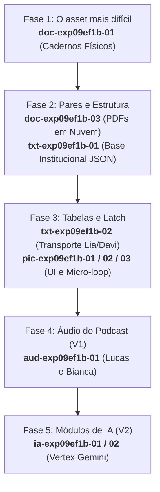

# Brief de assets — exp09ef1b (O Dossiê Invisível)

**Data de aprovação:** 2026-10-01  
**Público:** Curadoria pedagógica, estúdio de gravação de áudio, equipe de design visual/UI e engenharia de prompts.  
**Missão:** `exp09ef1b` — 9º ano EF · Ambiente: `chatgpt` (ChatGPT simulado) e `unooria` (Unooria Hub).  
**Princípio norteador:** Asset gravado, filmado ou desenhado contra mecânica que ainda pode oscilar é o maior custo de retrabalho do pipeline. Todo asset listado abaixo amarra-se a um identificador de tela do inventário e a um comportamento determinístico de telemetria.

---

## 1. Inventário

Classificação arquitetural em três blocos:
1. **Assets fixos de sistema/UI:** Ícones funcionais, demonstradores de gesto e brasões institucionais do ambiente clonado.
2. **Banco curado padrão (default/fallback):** Conjunto canônico homologado de documentos, relatórios, tabelas de contingência e podcast para uso imediato em 2 cliques ou em caso de cota de IA zerada.
3. **Assets sintéticos gerados por IA:** Prompts de sistema, templates estruturados e schemas Zod que a Vertex AI Gemini consome no preparo docente para gerar variantes curriculares (Ciências, Língua Portuguesa, História/Geografia).

| ID | Bloco | Tipo | Onde aparece (ID de tela) | Pareado com | V1/V2 | Peso estimado | Destino | Quem produz | Status |
|---|---|---|---|---|:---:|:---:|---|---|:---:|
| `pic-exp09ef1b-01` | Fixo UI | Pictograma de gesto / UI | `E3-ALU-01` | — | V1 | ~12 KB | bundle (`git`) | Design Visual | Pronto para corte |
| `pic-exp09ef1b-02` | Fixo UI | Pictograma de gesto / Animação | `E6-ALU-01` | — | V1 | ~95 KB | bundle (`git`) | Design / Animação UI | Pronto para corte |
| `pic-exp09ef1b-03` | Fixo UI | Ilustração de UI / Vetor | `E1-ALU-01`…`E6-ALU-02` | — | V1 | ~14 KB | bundle (`git`) | Design Visual | Pronto para corte |
| `doc-exp09ef1b-01` | Banco Default | Ilustração documental (fac-símile) | `E2-ALU-02`, `E4-ALU-01` | `doc-exp09ef1b-03` | V1 | ~180 KB | bundle (`git`) | Curadoria / Ilustração | Pronto para corte |
| `doc-exp09ef1b-02` | Banco Default | Texto / Estrutura documental | `E2-ALU-01` | — | V1 | ~15 KB | bundle (`git`) | Curadoria de Conteúdo | Pronto para corte |
| `doc-exp09ef1b-03` | Banco Default | Ilustração documental / UI | `E2-ALU-01`, `E4-ALU-01` | `doc-exp09ef1b-01` | V1 | ~120 KB | bundle (`git`) | Curadoria / UI | Pronto para corte |
| `txt-exp09ef1b-01` | Banco Default | Texto / Persona sintética | `E1-ALU-01`, `E2-ALU-01` | — | V1 | ~45 KB | bundle (`git`) | Curadoria de Conteúdo | Homologado |
| `txt-exp09ef1b-02` | Banco Default | Tabela estruturada / Dados | `E6-ALU-01` | — | V1 | ~18 KB | bundle (`git`) | Curadoria de Conteúdo | Homologado |
| `txt-exp09ef1b-03` | Banco Default | Texto diegético de apoio | `E6-ALU-02` | — | V1 | ~35 KB | bundle (`git`) | Curadoria de Conteúdo | Homologado |
| `aud-exp09ef1b-01` | Banco Default | Áudio de podcast (Recapitulação) | Pós-missão (`E6-PROF-01`) | — | V1 | ~3.8 MB | bucket (`-assets`) | Estúdio de Áudio | Roteiro aprovado |
| `ia-exp09ef1b-01` | Sintético IA | Prompt de sistema e Schema | `E0-PROF-02`, `E0-PROF-03` | — | V2 | ~8 KB | bundle (`git`) | Engenharia de IA | Especificado |
| `ia-exp09ef1b-02` | Sintético IA | Template de projeção e chat | `E0-PROF-04` | — | V2 | ~12 KB | bundle (`git`) | Engenharia de IA | Especificado |

---

## 2. Spec por tipo

### 2.1 Ilustrações documentais e fac-símiles (`doc-exp09ef1b-01` e `doc-exp09ef1b-03`)

* **Paridade obrigatória de assimetria:** O estudante confronta a documentação de dois projetos antagônicos. A categoria do documento (papel manuscrito vs. arquivo digital na nuvem) deve transmitir verossimilhança institucional, **sem que um pareça deliberadamente falso, ilegível ou desleixado**.
* `doc-exp09ef1b-01` (Cadernos Físicos de Campo — Mesa Aberta):
  * *O que aparece:* Foto fac-símile em tons de cinza de caderno pautado universitário aberto. Letra cursiva legível e firme de João (14 anos), demonstrando anotações diárias organizadas em colunas: "Data", "Estudante", "Refeição Servida", "Assinatura do Responsável". Carimbo institucional desbotado da Comissão de Recursos Comunitários (Fls. 142 a 174).
  * *Por que passa a impressão certa:* Parece um registro de campo real de quem não dispõe de computador na sede comunitária, mas opera com disciplina cotidiana rigorosa. Não parece papel amassado de lixo nem rabisco infantil.
  * *Fallback textual:* Transcrição completa em tabela Markdown para acessibilidade e contingência de erro (`MODO_ERRO_MIDIA`).
* `doc-exp09ef1b-03` (Pasta em Nuvem / Governança — Conexão para Continuar):
  * *O que aparece:* Pré-visualização de arquivos em formato PDF padronizado com cabeçalho corporativo, gráficos vetoriais de barra (tempo de tela e horas de pesquisa), tabelas de frequência geradas por software e selos de assinatura eletrônica.
  * *Por que passa a impressão certa:* Passa a imagem burocrática fria de governança técnica que encanta algoritmos de triagem automatizada, embora atenda 4 jovens a menos que o Mesa Aberta.

### 2.2 Textos estruturados e personas sintéticas (`txt-exp09ef1b-01`, `txt-exp09ef1b-02` e `txt-exp09ef1b-03`)

* `txt-exp09ef1b-01` (`base_dados_conselho.json` — Banco Canônico):
  * *Voz do Assistente de IA Simulado:* Formal, analítica, burocrática e impessoal. Jamais pede desculpas ou usa exclamações. Respostas com no máximo 120 palavras por bloco.
  * *Gatilho de bifurcação determinística:* Mapeamento de termos de intenção de busca para acionar o Caminho A (`"caderno"`, `"papel"`, `"físico"`, `"alimentação"`, `"registros"`, `"onde estão os dados"`).
* `txt-exp09ef1b-02` (Matriz de Dados de Transporte Escolar):
  * *Tabela A (Frequência Escolar):* Registro de 4 faltas de Lia (03/mar, 10/mar, 17/mar, 24/mar) e 4 faltas de Davi (04/mar, 11/mar, 18/mar, 25/mar).
  * *Tabela B (Relatório Operacional de Ônibus):* Cancelamentos mecânicos da Linha 302 exatamente em 03/mar, 10/mar, 17/mar e 24/mar. Bairro de Davi categorizado explicitamente com o status: `"Dados operacionais não informados pela concessionária"`.
* `txt-exp09ef1b-03` (Dossiê Histórico da Cidade):
  * *O que contém:* Artigo institucional de 220 palavras relatando a formação dos bairros periféricos do município, a ausência histórica de linhas de fibra ótica e a luta das cozinhas solidárias. Leitura assíncrona para estudantes que finalizam antes da turma, impedindo spoilers.

### 2.3 Pictogramas de gesto e UI (`pic-exp09ef1b-01`, `pic-exp09ef1b-02`, `pic-exp09ef1b-03`)

* `pic-exp09ef1b-01` (Glifos do Latch Decisório):
  * *Visual:* Conjunto SVG inline com 2 estados: Cadeado aberto (`lock_open`) e Cadeado travado (`lock`). Estilo Material Symbols Rounded, traço 2px uniforme, neutro e sem cores chamativas.
* `pic-exp09ef1b-02` (Demonstrador de Gesto de Pareamento Causal):
  * *Visual:* Micro-loop animado em SVG/CSS de exatamente 3 segundos que executa 1 ciclo didático: cursor do mouse surge, clica na célula "03/mar" da Tabela A, arrasta suavemente até a célula "03/mar" da Tabela B, e ambas ganham contorno de foco com linha conectora. O loop encerra-se e desaparece assim que o estudante executa o primeiro toque.
* `pic-exp09ef1b-03` (Brasão da Comissão Municipal):
  * *Visual:* Vetor SVG monocromático sóbrio (`brasao_conselho_cinza.svg`) posicionado no topo da barra lateral recolhível, conferindo legitimidade de órgão público colegiado.

### 2.4 Áudio de podcast (`aud-exp09ef1b-01`)

* **Título:** *Recapitulação Unooria — O Dossiê Invisível*
* **Duração exata:** Entre 3 minutos e 15 segundos e 3 minutos e 35 segundos (teto rígido: 3m30s).
* **Apresentadores:** Lucas (locução jovem, questionadora e clara) e Bianca (locução ágil, analítica e calorosa).
* **Tom:** Conversacional, instigante e radiofônico para 14–15 anos. Proibido tom professoral, condescendente ou infantilizado.
* **Capítulos de áudio (mixagem com trilha de fundo sutil):**
  * *00:00–00:30:* Abertura e o dilema dos R$ 12.000 indivisíveis na comissão.
  * *00:30–01:30:* A tentação dos 12 PDFs do Conexão vs. o déficit digital do Mesa Aberta.
  * *01:30–02:30:* A virada dos cadernos físicos de João e a inversão do parecer da máquina.
  * *02:30–03:15:* A transferência: por que o algoritmo quase cancelou o passe de Lia e Davi.
  * *03:15–03:30:* Fechamento ético: a responsabilidade pela justiça da decisão permanece humana.
* **Especificações técnicas de áudio:**
  * Masterização: -16 LUFS (padrão podcast/web). Formato: MP3 (192 kbps) e Opus (96 kbps para fallback rápido).
  * Sem ruídos de boca, sem eco de estúdio caseiro, tratamento com de-esser limpo.

### 2.5 Prompts e schemas para geração por IA (`ia-exp09ef1b-01` e `ia-exp09ef1b-02`)

* **Motor:** Vertex AI Gemini via `apps/api/src/ai`.
* **Guardrails inegociáveis de geração:**
  * Proibição total de PII (nomes de pessoas reais, escolas reais, telefones ou endereços existentes).
  * Estrutura tripartite imutável: Projeto A (urgência vital em cadernos manuais), Projeto B (intermediário) e Projeto C (infraestrutura digital completa em PDF).
  * A recomendação da IA gerada no Caminho B deve sempre favorecer o Projeto C e rebaixar o Projeto A. Quando os cadernos de Projeto A forem processados sob critérios idênticos de custo por pessoa, a recomendação deve obrigatoriamente se inverter para o Projeto A.

---

## 3. Critérios de reprovação (curtos e literais)

O asset será sumariamente **REPROVADO** se apresentar qualquer uma das seguintes não-conformidades:

1. **Assimetria de legibilidade nos documentos:** O caderno do Mesa Aberta parecer rasurado, ilegível ou desleixado, induzindo o estudante a rejeitá-lo por estética e não pela ausência de digitalização.
2. **Pessoa real ou criança identificável:** Qualquer foto ou fac-símile contendo imagem de rosto humano real, marca registrada corporativa, logo comercial ou nome de entidade verídica.
3. **Narração ou podcast fora do teto de tempo:** Podcast com duração inferior a 3 minutos e 15 segundos ou superior a 3 minutos e 45 segundos.
4. **Voz professoral ou infantilizada:** Apresentadores do podcast soando como animadores de auditório infantil ou emitindo julgamentos morais contra os estudantes que votaram induzidos pela IA.
5. **Asset pesado no Git/Bundle:** Qualquer arquivo de mídia estática com peso igual ou superior a 2.0 MB alocado no repositório de código (o áudio do podcast deve obrigatoriamente residir no bucket de CDN `-assets`).
6. **Ausência de ID ou tela de amarração:** Asset entregue sem identificador canônico (`<tipo>-exp09ef1b-<n>`) ou fora do inventário de 16 telas da jornada.
7. **Quebra de acessibilidade textual:** Fac-símile documental entregue sem a correspondente tabela de transcrição em Markdown para o fallback `MODO_ERRO_MIDIA`.
8. **Animação em loop eterno:** O micro-loop de gesto de pareamento continuar rodando na tela após a primeira interação do estudante.

---

## 4. Ordem de produção



### Detalhamento da sequência de produção

1. **Fase 1 — O asset mais difícil de calibrar (Produção Imediata — V1):**
   * Produzir `doc-exp09ef1b-01` (Fac-símile dos Cadernos de Campo). É o coração dramático do Aha. Precisa demonstrar rigor e organização física impecáveis, equilibrando textura de papel com clareza documental absoluta.
2. **Fase 2 — Par de contraste e base de dados (V1):**
   * Produzir `doc-exp09ef1b-03` (Gráficos e PDFs da Conexão para Continuar) em exato contraste com o caderno de João.
   * Fechar o arquivo estruturado `txt-exp09ef1b-01` (`base_dados_conselho.json`) com os nós de resposta do assistente simulado e regras de intenção de busca.
3. **Fase 3 — Tabelas de pareamento e componentes de UI (V1):**
   * Consolidar `txt-exp09ef1b-02` (Tabelas do caso do transporte escolar) e o texto de espera `txt-exp09ef1b-03`.
   * Exportar os pictogramas de UI `pic-exp09ef1b-01`, o vetor do brasão `pic-exp09ef1b-03` e animar o micro-loop `pic-exp09ef1b-02` (3 segundos).
4. **Fase 4 — Gravação e masterização do podcast (V1):**
   * Gravar `aud-exp09ef1b-01` em estúdio profissional após o sheet de copy revisado estar 100% congelado. Fazer upload direto para o bucket de assets (`edu-assets-exp09ef1b`).
5. **Fase 5 — Engenharia de prompts e schemas dinâmicos (V2):**
   * Validar na API os schemas Zod `ia-exp09ef1b-01` e os testes de geração transversal com Vertex AI Gemini.

---

## 5. Decisões de curadoria reutilizáveis e lacunas

### 5.1 Decisões de curadoria reutilizáveis

1. **Falso déficit vs. Trabalho real:** A curadoria estabelece a regra de ouro para missões de auditoria algorítmica: o projeto prejudicado nunca é deficiente em seu trabalho comunitário; a deficiência reside estritamente na ausência de rastreabilidade digital. Isso assegura que o julgamento do estudante recaia sobre os dados, não sobre a idoneidade da entidade.
2. **Bifurcação determinística sem alucinação:** Para manter a integridade avaliativa em escala escolar, o assistente corporativo do ChatGPT simulado opera sobre grafo documental local (`base_dados_conselho.json`), garantindo que a mesma pergunta receba a mesma resposta em qualquer laboratório escolar do país.
3. **Proteção cognitiva pós-conclusão:** O "Dossiê Histórico da Cidade" funciona como asset de contenção para desníveis de ritmo na sala de aula: acolhe o estudante mais rápido sem oferecer spoilers aos colegas que ainda deliberam no Pico.

### 5.2 Lacunas e donos

*Nenhuma lacuna técnica ou pedagógica aberta. O inventário, os formatos de entrega, as amarrações de telas e os limites de peso estão 100% integrados à especificação do produto.*

---

```json
{
  "agente": "brief-assets",
  "missao": "exp09ef1b",
  "status": "concluido",
  "achados": [],
  "precisa_humano": false
}
```
