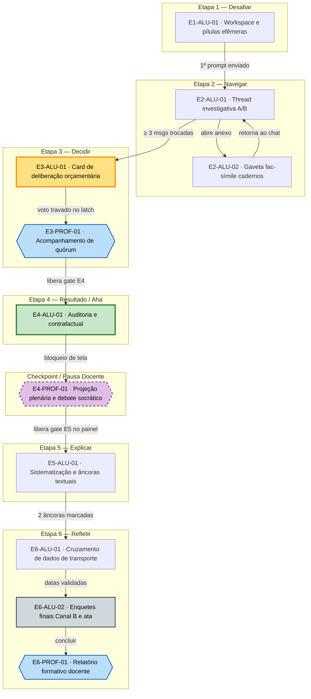

# Jornada — exp09ef1b

**Ambiente:** ChatGPT (`chatgpt`) · classe: app clonado · **telas no inventário:** 16

---

## Seção 1 — Mapa de jornada

| Dimensão | 1. Desafiar | 2. Navegar | 3. Decidir | 4. Resultado / Aha | ⟨CHECKPOINT / PAUSA DOCENTE⟩ | 5. Explicar | 6. Refletir |
|---|---|---|---|---|:---:|---|---|
| **Conformidade de ambiente** | ✅ Dentro (`chatgpt`) | ✅ Dentro (`chatgpt`) | ✅ Dentro (`chatgpt`) | ✅ Dentro (`chatgpt`) | ⚡ Escape (Projeção / Plenária) | ✅ Dentro (`chatgpt`) | ✅ Dentro (`chatgpt`) |
| **Preparação docente** | Seleciona `exp09ef1b` e define recorte ou ativa banco padrão no Hub | Observa taxa de dispersão e bifurcação de caminhos no dashboard | Monitora quorum de votos homologados via polling | Prepara projeção do gráfico de votação da sala | Mediação do debate socrático (12 min) com projeção da dispersão | Libera gate E5 no painel após conclusão do debate | Analisa consolidação final dos níveis de `EF09CO07` e `EF09CO08` |
| **Estudante — vê** | Notificação do conselho, cards dos 3 projetos, provocação de Amara e 3 pílulas efêmeras | Thread com respostas da IA consultando base local; relatórios em PDF vs anotação de déficit | Card `ChatDecisionLatchEmbed` com seleção exclusiva e enquete `ChatPollEmbed` | Resposta da IA com auditoria convocada e tabela comparativa de critérios | Telão com gráfico de votos da sala e debate conduzido pelo professor | Card formativo de Amara e histórico com ferramenta de ancoragem (*highlight*) | Caso de transporte: tabelas de Lia e Davi, Linha 302 e enquetes `ChatPollEmbed` |
| **Estudante — faz** | `Clicar em pílula de sugestão` ou `Digitar prompt` | `Digitar prompt`, `Clicar em anexo/arquivo` | `Selecionar alternativa em enquete (ChatPollEmbed)`, `Travar deliberação (ChatDecisionLatchEmbed)` | Leitura da inversão algorítmica e escuta ativa da plenária | Participação oral no debate mediado; sem interação direta no terminal | `Digitar prompt` (busca de termos) e seleção das 2 mensagens no histórico | `Cruzar linhas de tabelas`, `Selecionar alternativa em enquete (ChatPollEmbed)` |
| **Estudante — o que muda** | Pílulas desaparecem permanentemente; prompt é renderizado na thread | IA retorna relatórios digitais ou cadernos físicos conforme termos de busca | Radio button marca projeto; outros dois viram "fila de espera"; tela trava com cadeado | IA reprocessa dados com cadernos e inverte o ranking em favor do Mesa Aberta | Terminais individuais congelam com banner diegético de sessão plenária | Mensagens corretas ganham borda verde de validação de evidência | Linhas conectam as 4 datas de Lia em verde; enquete decisória é liberada |
| **Estudante — estado interno** | Curiosidade burocrática; percepção de tarefa simples de triagem | Indução pelo volume técnico (Caminho B) ou suspeita ativa de dados ausentes (Caminho A) | Tensão máxima (**PICO**): responsabilidade ética e escassez dos R$ 12.000 indivisíveis | Quebra de expectativa (**AHA**): choque ao ver a IA julgar papel vs PDF | Desestabilização compartilhada e articulação crítica coletiva | Clareza conceitual (**MEMORÁVEL**): nomeação de viés algorítmico e dados do passado | Autonomia crítica: aplicação do rigor investigativo para proteger pessoas reais |
| **Professor (condução ao vivo)** | Abre a missão e instrui a turma a assumir o crachá de conselheiro | Circula entre as bancadas sem dar pistas sobre os cadernos de João | Alerta para o peso do voto irreversível e aguarda todos travarem | Congela telas e projeta gráfico de barras de votos da sala | Conduz as 3 perguntas norteadoras sobre o valor do trabalho não digitalizado | Orienta retorno aos terminais individuais para sistematização | Lança a pergunta-ponte sobre sistemas automatizados no cotidiano |
| **Gatilho de handoff** | Envio do 1º prompt (automático) | Clique em "Emitir Parecer Vinculante" após ≥ 3 trocas (automático) | Trava no latch vinculante e acionamento do gate E4 docente (dashboard) | Trava do gate E5 no término da leitura da auditoria (automático) | Liberação manual do gate E5 pelo professor via dashboard (HTTP polling) | Validação das 2 âncoras textuais no histórico (automático) | Clique em "Concluir Missão" chamando `SDK.concluir()` (automático) |
| **Plataforma durante mediação** | Continua interativa | Continua interativa | Trava terminal em `E3_LATCH_LOCKED` | Continua interativa até o rodapé | Trava terminal em `E4_AGUARDANDO_DEBATE` (prompt desabilitado) | Continua interativa | Trava terminal em `E6_CONCLUIDO` em modo de leitura |
| **Evidência capturada** | `attempted missao:iniciar`, `interacted chat:pilula_sugestao` | `caminho_tomado` ("A" ou "B"), `interacted chat:desbloquear_cadernos` | `voto_etapa3`, `scored decisao:homologar`, `scored poll:submeter_canal_a_e3` | Leitura da auditoria, `progressed etapa:entrar` | Presença no debate (observação pedagógica qualitativa) | Marcação das 2 mensagens de viés no histórico | `interacted tabela:cruzar_datas`, `scored poll:submeter_canal_a_e6`, Canal B |
| **Telas (IDs)** | `E1-ALU-01` | `E2-ALU-01`, `E2-ALU-02` | `E3-ALU-01`, `E3-PROF-01` | `E4-ALU-01` | `E4-PROF-01` | `E5-ALU-01` | `E6-ALU-01`, `E6-ALU-02`, `E6-PROF-01` |

---

## Seção 1b — Diagrama da jornada



---

## Seção 1c — Jornada do professor (preparo e condução)

| Passo | 1. Escolher a missão | 2. Recorte da aula | 3. Geração pela IA | 4. Curadoria do pacote | 5. Ativar / agendar | 6. Conduzir (gates) | 7. Depois (relatório) |
|---|---|---|---|---|---|---|---|
| **Professor — vê** | Catálogo de missões do 9º ano EF, Unidade 1, card `exp09ef1b` ("O Dossiê Invisível") | Formulário de recorte temático: disciplina, tema, assuntos, contexto, foco; botão "Usar banco padrão" | Barra de progresso assíncrona por polling HTTP com status de geração das entidades | Tela de prévia dos 3 projetos sociais, respostas do chat e cadernos de campo; botões de edição | Opções de turma, agendamento de data/horário ou liberação imediata da missão | Painel ao vivo com gráfico de barras de votos, dispersão Caminho A vs B e controle de gates E4 e E5 | Relatório formativo consolidado com níveis das habilidades `EF09CO07` e `EF09CO08` por aluno |
| **Professor — faz** | Clica em "Configurar Missão" no card | Seleciona componente curricular e preenche parâmetros de aula (ou clica no atalho "Usar banco padrão") | Aguarda síntese ou clica em cancelar para retornar ao formulário | Revisa textos, edita nomes/dados pontuais, clica em "Regenerar item" se necessário e em "Aprovar" | Seleciona a turma desejada e clica em "Liberar para a Turma" | Projeta gráfico de votos na Etapa 4, conduz o debate socrático e clica para abrir gates | Exporta dados formativos ou planeja intervenções pedagógicas de recuperação |
| **O que muda na tela** | Abre gaveta de configuração da turma | Habilita botão "Gerar com IA" ou avança direto para curadoria (se banco padrão) | Indicadores de status mudam de "gerando projetos" para "concluído" | Campos tornam-se editáveis em linha; badge muda para "Pacote Validado" | Gera link de acesso discente e exibe confirmação com PIN da turma | Dashboard atualiza quórum em tempo real; botões de gate passam de "Aguardando" para "Liberado" | Gera gráficos de dispersão de aprendizagem e tabela individual por descritor |
| **O que a plataforma faz** | Carrega metadados da missão e consulta saldo de cota de IA | Valida campos contra `ParametrosPreparoExp09Schema` e dispara requisição assíncrona | Roda geração na Vertex AI Gemini com schema Zod estrito; se erro 429, ativa fallback padrão | Grava edições em `exp09ef1b_conteudo_turma` e congela pacote homologado | Persiste liberação em `exp09ef1b_gates_turma` com estado inicial `E1` | Registra timestamps em `exp09ef1b_gates_historico` e sincroniza terminais via polling (3s) | Agrega respostas discretas em `exp09ef1b_sessoes` e calcula níveis ternários no backend |
| **Estado** | `vazio` | `recorte_definido` | `gerando` (ou `sem_saldo`) | `pacote_pronto` (ou `editado`) | `ativado` | `em_conducao` | `concluido` |

### A mesma missão em três aulas (Variação de Curadoria no Hub)

| Disciplina | Recorte do professor no Hub | O que muda na tela de curadoria (`E0-PROF-04`) | O que permanece idêntico na estrutura |
|---|---|---|---|
| **Língua Portuguesa** | *Acesso à literatura e combate à desinformação periférica.* | Projeto A: Saraus e biblioteca comunitária em cadernos de empréstimo; Projeto B: Cartilhas contra fake news; Projeto C: Podcast e blog digital com métricas de engajamento na nuvem. | Verba de R$ 12.000 indivisível; IA ranqueia Projeto C pelo volume de métricas digitais; cadernos físicos de Projeto A revelam alcance comunitário omitido; trava irreversível no latch. |
| **Ciências / Biologia** | *Saneamento ambiental, horta agroecológica e saúde comunitária.* | Projeto A: Horta comunitária contra insegurança alimentar com cadernos manuais de colheita; Projeto B: Coleta seletiva; Projeto C: Sensores de qualidade do ar com relatórios digitais na nuvem. | Verba de R$ 12.000 indivisível; IA recomenda Projeto C por relatórios automatizados; cadernos físicos de Projeto A mostram 100 famílias alimentadas; caso Lia/Davi idêntico. |
| **História / Geografia** | *Preservação de memória quilombola/indígena e vulnerabilidade urbana.* | Projeto A: Preservação de história oral com cadernos manuscritos de anciãos; Projeto B: Cartografia de encostas; Projeto C: Digitalização de acervo histórico com catálogo digital em PDF e planilhas. | Verba de R$ 12.000 indivisível; IA privilegia Projeto C pela indexação digital; registros orais em caderno manuscrito invertem o parecer; caso Lia/Davi idêntico. |

---

## Seção 2 — Cenários de dispositivo

| Dimensão | 1 estudante / dispositivo (Cenário Referência) | 2–4 por dispositivo (Bancada Colegiada) | Projeção única (Contingência de Rede) |
|---|---|---|---|
| **O que muda na dinâmica** | Autonomia investigativa completa; experimentação direta e isolada da dúvida ética; impacto individual e pessoal no latch. | Formação de comissão deliberativa; negociação entre pares sobre quais prompts disparar e qual projeto homologar no rádio. | O professor atua como escrivão da plenária; os estudantes debatem em voz alta e decidem os passos coletivamente. |
| **O que muda na tela** | O terminal responde estritamente às escolhas de digitação e navegação de um único estudante. | A tela é compartilhada; um estudante digita enquanto os demais analisam os relatórios projetados no monitor. | A interface é exibida na lousa digital/TV; botões e prompts são acionados pelo professor sob comando da sala. |
| **Descoberta central chega?** | **Sim.** O estudante sente diretamente o choque contrafactual de ter sido induzido pela frieza técnica da máquina. | **Sim.** Potencializada pelo debate prévio da bancada, onde membros podem ter divergido sobre o valor dos PDFs vs cadernos. | **Sim.** Preservada através da votação por braços erguidos em plenária e confronto coletivo com a inversão da IA. |
| **Evidência registrada** | Medição individualizada (`scored`) vinculada ao crachá individual de cada estudante no banco de dados. | Medição atribuída ao identificador da bancada ou do estudante operador logado no terminal compartilhado. | Registro de sessão coletiva institucional operada pelo professor; evidências individuais colhidas no caderno físico. |

---

## Seção 3 — Inventário de telas

| ID | Etapa | Ator | Ambiente | Propósito | Peso | Elementos na tela | Ação (verbo nativo) | Resultado da ação | Estados | Cenário de dispositivo | Habilidade |
|---|---|---|---|---|---|---|---|---|---|---|:---:|
| `E0-PROF-01` | Preparo | Professor | Unooria Hub | Selecionar missão no catálogo | Serviço | Card de missão com metadados, botão "Configurar", botão "Usar banco padrão" | Clicar em botão do Hub | Abre gaveta de parametrização da missão | Padrão | 1:1, bancada, projeção | — |
| `E0-PROF-02` | Preparo | Professor | Unooria Hub | Definir recorte temático da aula | Alta | Formulário com 5 campos estruturados, seletores de disciplina, botões de ação | Preencher campos e clicar em gerar | Dispara chamada de IA para Vertex Gemini | Vazio, preenchido, sem saldo | 1:1, bancada, projeção | — |
| `E0-PROF-03` | Preparo | Professor | Unooria Hub | Feedback de geração assíncrona | Serviço | Barra de progresso em porcentagem, status das entidades, botão cancelar | Aguardar ou cancelar | Conclui geração e avança para curadoria | Gerando, falha/sem saldo | 1:1, bancada, projeção | — |
| `E0-PROF-04` | Preparo | Professor | Unooria Hub | Curadoria e aprovação do pacote | Alta | Cards editáveis dos 3 projetos, extrato dos cadernos, respostas da IA, botão "Aprovar" | Editar texto, regenerar item e aprovar | Homologa pacote de dados da turma | Prévia, editado, aprovado | 1:1, bancada, projeção | — |
| `E0-PROF-05` | Preparo | Professor | Unooria Hub | Ativar ou agendar para a turma | Serviço | Dropdown de seleção de turma, seletor de data/hora, botão "Liberar para a Turma" | Clicar em ativar ou agendar | Persiste liberação em `exp09ef1b_gates_turma` | Padrão, agendado, ativado | 1:1, bancada, projeção | — |
| `E1-ALU-01` | E1 | Estudante | ChatGPT (`chatgpt`) | Apresentar o dilema orçamentário e disparar 1ª ação | Alta | Sidebar fixa do conselho, balão de Amara, 3 cards de projetos, 3 pílulas efêmeras, composer | `Clicar em pílula de sugestão` ou `Digitar prompt` | Destrói `ChatSuggestionsEmbed` e renderiza prompt na thread | Inicial com pílulas, digitando | 1:1 (individual), bancada (colegiado) | — |
| `E2-ALU-01` | E2 | Estudante | ChatGPT (`chatgpt`) | Investigar relatórios e disparar bifurcação A/B | Alta | Thread contínua, balões da IA com relatórios em PDF, ficha do Mesa Aberta, composer | `Digitar prompt`, `Clicar em anexo/arquivo` | Retorna respostas simuladas e links para cadernos físicos se pesquisados | Investigação livre, cadernos oferecidos | 1:1 (individual), bancada (colegiado) | — |
| `E2-ALU-02` | E2 | Estudante | ChatGPT (`chatgpt`) | Inspecionar extrato dos cadernos físicos | Média | Gaveta lateral fac-símile com extrato de registros de frequência e fotos de manuscritos | `Clicar em anexo/arquivo` (fechar) | Fecha a gaveta lateral e retorna o foco para a thread do chat | Visualização gráfica, fallback textual | 1:1 (individual), bancada (colegiado) | — |
| `E3-ALU-01` | E3 | Estudante | ChatGPT (`chatgpt`) | Deliberação vinculante dos R$ 12.000 e enquete | **Pico** | Card `ChatDecisionLatchEmbed`, 3 opções em rádio, enquete `ChatPollEmbed`, botão irreversível | `Selecionar alternativa em enquete (ChatPollEmbed)`, `Travar deliberação (ChatDecisionLatchEmbed)` | Trava seleções permanentemente (`latch: locked`) e grava voto | Aberto desabilitado, habilitado, travado | 1:1 (individual), bancada (colegiado) | `EF09CO08` |
| `E3-PROF-01` | E3 | Professor | Unooria Hub | Monitorar votos travados e controle do gate E4 | Serviço | Painel de monitoramento com contador de votos recebidos e botão "Liberar Gate E4" | Clicar em liberar gate E4 | Atualiza status no banco liberando a revelação nos terminais | Quórum parcial, quórum completo | 1:1, bancada, projeção | — |
| `E4-ALU-01` | E4 | Estudante | ChatGPT (`chatgpt`) | Revelação da auditoria e inversão algorítmica | Alta | Badge de auditoria, interpolação do voto discente, tabela comparativa de critérios | Leitura da tela (sem ação interativa) | Prepara para o debate; campo de prompt fica desabilitado | Auditoria Caminho A, Auditoria Caminho B | 1:1 (individual), bancada (colegiado) | — |
| `E4-PROF-01` | E4 | Professor | Unooria Hub / Projeção | Conduzir debate da virada e projetar votos | Alta | Gráfico de dispersão da sala (Caminho A vs B), distribuição de votos, roteiro socrático | Clicar em projetar dados e em liberar gate E5 | Destrava terminais individuais para a etapa Explicar | Gráfico projetado, gate liberado | Projeção na lousa / telão coletivo | — |
| `E5-ALU-01` | E5 | Estudante | ChatGPT (`chatgpt`) | Sistematizar conceitos e ancorar evidências | Alta | Card conceitual de Amara, histórico do chat com ferramenta interativa de seleção de trechos | `Digitar prompt` (busca) e selecionar 2 âncoras | Valida marcação das mensagens e habilita botão para Refletir | Âncoras vazias, 1 marcada, 2 validadas | 1:1 (individual), bancada (colegiado) | — |
| `E6-ALU-01` | E6 | Estudante | ChatGPT (`chatgpt`) | Pareamento de dados do transporte escolar | Alta | Tabelas lado a lado (Faltas Lia/Davi vs Linha 302), linhas interativas conectadas em verde | `Cruzar linhas de tabelas` | Valida 4 pares causais de Lia e destrava `ChatPollEmbed` | Neutro, pareando, 4 pares confirmados | 1:1 (individual), bancada (colegiado) | `EF09CO07` |
| `E6-ALU-02` | E6 | Estudante | ChatGPT (`chatgpt`) | Enquetes finais Canal B e conclusão formal | Média | Componente `ChatPollEmbed` com perguntas conceituais de Canal B, botão "Concluir Missão" | `Selecionar alternativa em enquete (ChatPollEmbed)` | Registra respostas de Canal B, invoca `SDK.concluir()` e congela ata | Enquetes abertas, respondidas, concluído | 1:1 (individual), bancada (colegiado) | `EF09CO07`, `EF09CO08` |
| `E6-PROF-01` | E6 | Professor | Unooria Hub | Visualizar relatório formativo da turma | Serviço | Dashboard consolidado com matriz de evidências, níveis ternários e gráficos por habilidade | Clicar em exportar relatório ou filtrar | Apresenta diagnóstico consolidado para conselho de classe | Em andamento, turma concluída | 1:1, bancada, projeção | — |

---

## Seção 4 — Direção por tela (só `pico` e `alta`)

| Tela | Beat que carrega | O que salta primeiro (um único elemento) | O que recua (obrigatório) | Teto de elementos (contado) | Não-negociável honrado |
|---|---|---|---|:---:|---|
| `E0-PROF-02` | Preparo Docente | Card central de parametrização temática da aula | Instruções de ajuda e menu de navegação lateral do Hub | 6 | Customização por professor preservando a camada fixa inegociável. |
| `E0-PROF-04` | Preparo Docente | Botão verde de ação primária "Aprovar Pacote Curado" | Metadados de tokens e logs de geração da IA | 7 | Aprovação curatorial humana obrigatória antes da liberação à turma. |
| `E1-ALU-01` | Beat 1 e 2 (Convocação e Disparo) | Três pílulas de prompt efêmeras flutuando sobre a barra | Sidebar do workspace institucional e cabeçalho do conselho | 6 | Efemeridade total das pílulas de abertura (destruição após 1º uso). |
| `E2-ALU-01` | Beat 3 (Triagem Assimétrica) | Alerta da IA sobre o "Déficit documental do Mesa Aberta" | Campo de entrada de texto e controles de rolagem do chat | 6 | Bifurcação investigativa estrita (Caminho A via busca vs Caminho B induzido). |
| `E3-ALU-01` | **Beat 4 (Latch Irreversível — PICO)** | **Botão formal "Homologar Voto Irreversível" com ícone de cadeado** | **Sidebar lateral, campo inferior de chat e histórico prévio da conversa** | **4** | **Trava irreversível por Latch Decisório (proibição de reabertura ou fracionamento).** |
| `E4-ALU-01` | Beat 5 (Inversão dos Cadernos — AHA) | Tabela comparativa em split-view demonstrando a inversão do ranking | Barra inferior de digitação (que passa ao estado desabilitado) | 6 | Inversão algorítmica direta sem renegociação de pesos no Resultado/Aha. |
| `E4-PROF-01` | Beat 5 (Mediação da Virada) | Gráfico de barras da sala projetando a concentração de votos no Conexão | Controles administrativos da conta docente e listas de chamada | 6 | Bloqueio de avanço para a sistematização condicionado à mediação docente. |
| `E5-ALU-01` | Beat 6 (Desmonte do Algoritmo — MEMORÁVEL) | Card assinado por Amara com as 4 caixas conceituais em destaque | Barra de prompt e rodapé de navegação do ChatGPT | 6 | Ancoragem direta no histórico de mensagens gerado pelo próprio estudante. |
| `E6-ALU-01` | Beat 7 (Caso Lia e Davi) | Células da Tabela A e B destacadas em verde com linha de conexão | Avisos de sistema e campos opcionais de anotação facultativa | 7 | Pareamento causal obrigatório de datas antes da deliberação de transporte. |

### Nota de aderência ao mapa de beats
* **PICO (Beat 4):** Centralizado com rigor absoluto na tela `E3-ALU-01`. Seu teto de elementos foi reduzido para **4 elementos** (o menor do trecho de ação e rigorosamente menor que suas vizinhas `E2-ALU-01` [6] e `E4-ALU-01` [6]), garantindo que o botão com cadeado seja o ponto focal exclusivo de peso institucional.
* **AHA (Beat 5):** Sustentado na tela `E4-ALU-01` pela inversão da recomendação da IA exibida nativamente na thread através da tabela comparativa de critérios, sem uso de popups ou quebra da ficção de chat corporativo.
* **MEMORÁVEL (Beat 6):** Ancorado na tela `E5-ALU-01` pela reentrada cirúrgica de Amara e pela ferramenta de marcação de trechos que conecta os conceitos formais diretamente aos dados vivenciados na investigação discente.
* **Afastamentos:** Nenhum afastamento em relação ao briefing e à spec. Todos os não-negociáveis e arcos foram rigorosamente respeitados.

---

## Seção 5 — Regras, fases e mecânicas (só quando o ambiente é mini-jogo)

`n/a — ambiente é app clonado (chatgpt)`

---

## Lacunas

*Nenhuma lacuna encontrada. A spec consolidada e o briefing de ofício fornecem mecanismos completos, estados determinísticos e variáveis de medição suficientes para governar todas as raias e telas.*

---

## Contagens

* **Decisões do mesmo tipo:** 2 decisões vinculantes na missão inteira (destinação da verba na Etapa 3 e parecer de transporte na Etapa 6) vs cap de 2 a 3 por ato.
* **Telas no inventário:** 16
  * `pico`: 1 (`E3-ALU-01`)
  * `alta`: 8 (`E0-PROF-02`, `E0-PROF-04`, `E1-ALU-01`, `E2-ALU-01`, `E4-ALU-01`, `E4-PROF-01`, `E5-ALU-01`, `E6-ALU-01`)
  * `média`: 2 (`E2-ALU-02`, `E6-ALU-02`)
  * `serviço`: 5 (`E0-PROF-01`, `E0-PROF-03`, `E0-PROF-05`, `E3-PROF-01`, `E6-PROF-01`)
* **Mini-jogo:** `n/a`

---

## Pronto — contagem por item

| Verificação | Contagem |
|---|:---:|
| Célula de raia vazia sem `⚠️ lacuna` | 0 |
| Tela no inventário sem etapa ou sem ator | 0 |
| Tela sem `Peso` atribuído | 0 |
| Tela `pico` além de uma | 0 |
| Tela `pico` ou `alta` sem linha na Seção 4 | 0 |
| Beat marcado no mapa de beats sem tela que o carregue | 0 |
| Verbo na jornada fora da lista de verbos do bloco 4 da spec | 0 |
| Cenário de dispositivo com "descoberta chega?" em branco | 0 |
| **Total de itens abertos** | **0** |

---

```json
{
  "agente": "jornada",
  "missao": "exp09ef1b",
  "status": "concluido",
  "artefatos": [
    {
      "caminho": "design/02-jornada-telas.md",
      "titulo": "Jornada"
    }
  ],
  "achados": [],
  "pronto": {
    "verificado": true,
    "itens_abertos": 0
  },
  "precisa_humano": false
}
```
