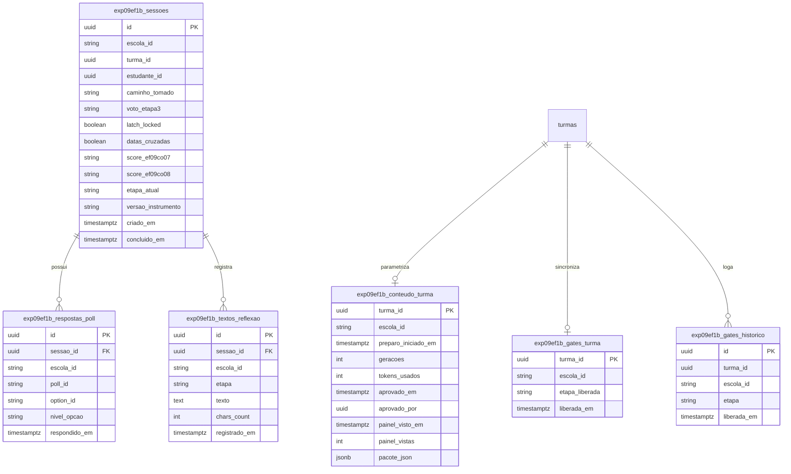

# 11. Modelo de dados

### Entidades do módulo `exp09ef1b`

- **`exp09ef1b_sessoes`**: Sessão do estudante. PK: `id UUID`, UK: `[escola_id, turma_id, estudante_id]`. Campos: `caminho_tomado VARCHAR(2)` (CHECK `'A'`, `'B'`), `voto_etapa3 VARCHAR(30)`, `latch_locked BOOLEAN`, `datas_cruzadas BOOLEAN`, `score_ef09co07 VARCHAR(20)`, `score_ef09co08 VARCHAR(20)`, `etapa_atual VARCHAR(30)`, `versao_instrumento VARCHAR(10)`. RLS `ENABLE` + `FORCE` por `escola_id`.
- **`exp09ef1b_conteudo_turma`**: Pacote temático parametrizado da turma. PK: `turma_id UUID`. Campos: `escola_id TEXT`, `preparo_iniciado_em TIMESTAMPTZ`, `geracoes INT`, `tokens_usados INT`, `aprovado_em TIMESTAMPTZ`, `aprovado_por UUID`, `painel_visto_em TIMESTAMPTZ`, `painel_vistas INT`, `pacote_json JSONB`. RLS `ENABLE` + `FORCE`.
- **`exp09ef1b_gates_turma`**: Estado corrente de sincronização da sala. PK: `turma_id UUID`. Campos: `escola_id TEXT`, `etapa_liberada VARCHAR(20)` (CHECK `'E1'`, `'E4'`, `'E5'`), `liberada_em TIMESTAMPTZ`. RLS `ENABLE` + `FORCE`.
- **`exp09ef1b_gates_historico`**: Log append-only de abertura de gates (`EVT-P05`). PK: `id UUID`. Campos: `turma_id UUID`, `escola_id TEXT`, `etapa VARCHAR(20)`, `liberada_em TIMESTAMPTZ`. RLS `ENABLE` + `FORCE`.
- **`exp09ef1b_respostas_poll`**: Respostas das enquetes estructuradas (`ChatPollEmbed`). PK: `id UUID`, FK: `sessao_id`. Campos: `escola_id TEXT`, `poll_id VARCHAR(40)`, `option_id VARCHAR(40)`, `nivel_opcao VARCHAR(20)` (CHECK `'atingiu'`, `'em_processo'`, `'nao_atingiu'`). RLS `ENABLE` + `FORCE`.
- **`exp09ef1b_textos_reflexao`**: Tabela isolada para texto livre facultativo de menor de idade. PK: `id UUID`, FK: `sessao_id`. Campos: `escola_id TEXT`, `etapa VARCHAR(20)`, `texto TEXT`, `chars_count INT`. RLS `ENABLE` + `FORCE`. Acesso exclusivo do professor da turma.

### Diagrama Mermaid — `erDiagram`

---

