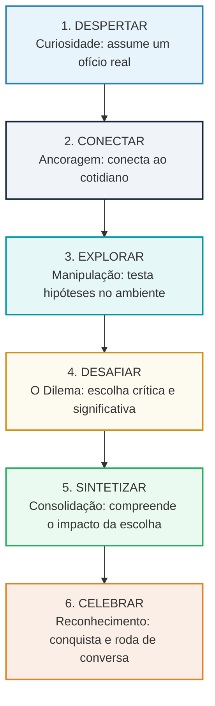
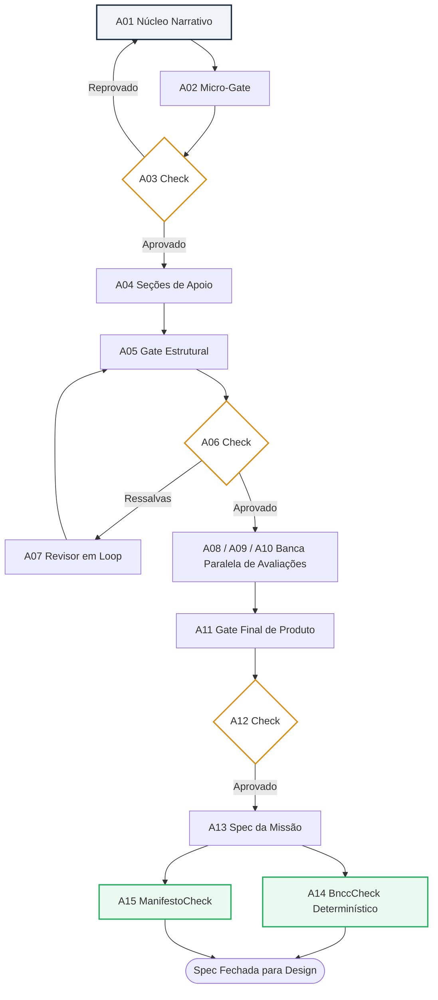
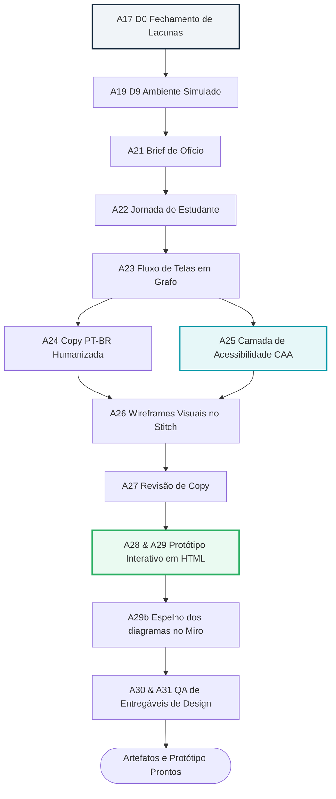
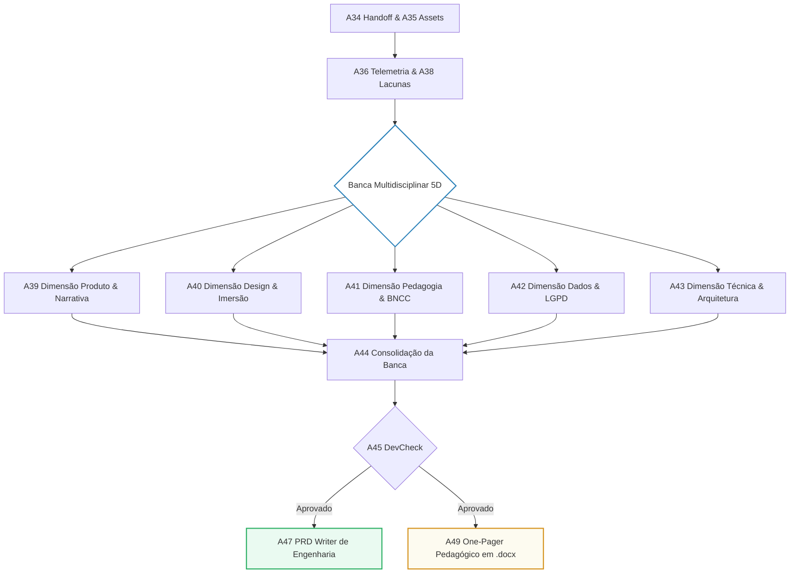

# Manual Completo e Explicativo do Gerador de Missões Unooria
## Arquitetura Global Multiagente, Lógica Pedagógica, Guardrails Éticos e o Primado do Letramento Digital

---

### Apresentação Executiva

O **Gerador de Missões Unooria** é uma esteira automatizada de inteligência artificial multiagente concebida para converter uma intencionalidade pedagógica em uma experiência digital interativa, lúdica, curricularmente rigorosa, segura para crianças e pronta para desenvolvimento em escala.

Este manual consolida a análise global de todo o sistema, cobrindo:
1. **Visão Geral e Filosofia da Plataforma**
2. **Topologia Multiagente e a Divisão dos Agentes Especialistas**
3. **Fundamentação Pedagógica e Sentido Didático**
4. **Alinhamento Curricular e o Primado do Letramento Digital**
5. **Guardrails, Ética e Proteção Integral de Menores (LGPD)**
6. **Diagramas de Fluxo e Funcionamento Passo a Passo**
7. **Checklist de Ouro e Boas Práticas**

---

## 1. O que é o Gerador de Missões Unooria?

Na criação tradicional de tecnologia educacional (*EdTech*), existe um descompasso estrutural entre três mundos:
* **Pedagogia:** Formula objetivos conceituais ricos, mas muitas vezes sem os parâmetros técnicos de mecânica de jogos;
* **Design de Jogos:** Constrói interfaces envolventes, mas corre o risco de criar jogos puramente cosméticos, onde o conteúdo vira mero "texto para pular";
* **Engenharia de Software:** Entrega código robusto, mas pode desconsiderar os desafios práticos da sala de aula brasileira (telas pequenas, ruído, internet oscilante).

O Gerador de Missões funciona como um **estúdio colaborativo de criação autônoma**. Nele, mais de 50 agentes de inteligência artificial especializados trabalham de forma coordenada:
1. Um time de roteiristas e pedagogos virtuais (**Área de Produto**) estrutura o núcleo da aprendizagem;
2. Designers e redatores virtuais (**Área de Design**) projetam a interface, a linguagem e o protótipo navegável;
3. Arquitetos técnicos e examinadores sêniores (**Área de Dev**) auditam segurança, dados e geram o PRD de engenharia;
4. Inspetores determinísticos e agentes de diagnóstico (**Área Transversal**) gravam aprendizados para as próximas missões.

---

## 2. Topologia Multiagente e Divisão de Responsabilidades

### Por que tantos agentes?
Modelos de Linguagem de Grande Porte (LLMs) perdem qualidade drasticamente quando acumulam instruções gigantescas em um único prompt (*efeito "Lost in the Middle"*, Liu et al., 2024).

Adotamos o **Princípio da Responsabilidade Única (SRP)** da engenharia de software:
* Cada agente faz uma única coisa com maestria;
* Agentes de criação nunca avaliam a si próprios (avaliação adversarial e triangulação independente);
* Guardrails matemáticos em código puro barram alucinações antes que avancem na esteira.

### Mapa Completo dos Agentes

| Estágio | Agente(s) | Papel Operacional | O que consome | O que produz |
|---|---|---|---|---|
| **Produto** | `A01NucleoNarrativo` | Constrói a descoberta pedagógica e a jornada em 6 etapas | Briefing do professor e anexos | Núcleo narrativo bruto |
| **Produto** | `A02MicroGate` & `A03Check` | Audita spoilers e falsos desafios | Núcleo de A01 | Veredito imediato de reescrita |
| **Produto** | `A04SecoesApoio` | Constrói seções de logística, contexto e público | Núcleo aprovado | One-Pager Canônico |
| **Produto** | `A05Gate` / `A06Check` / `A07Revisor` | Loop estrutural de 23 critérios escolares | One-Pager | One-Pager polido e sem ressalvas |
| **Produto** | `A08` / `A09` / `A10` | Banca Paralela: Pedagogia, Experiência e Escola Pública | One-Pager | 3 notas e pareceres independentes |
| **Produto** | `A11GateFinal` & `A12Check` | Veredito final de Produto | Pareceres da banca | Liberação formal da missão |
| **Produto** | `A13SpecMissao` | Redige o contrato formal da missão em 12 blocos | One-Pager aprovado | Especificação Técnica da Missão |
| **Produto** | `A14BnccCheck` | **Guardrail determinístico de BNCC e Letramento Digital** | Blocos de BNCC da Spec | Veredito de bloqueio ou aprovação |
| **Produto** | `A15ManifestoCheck` | Guardrail determinístico de integridade de metadados | Manifesto do pipeline | Rastro de auditoria |
| **Design** | `A17FechaLacunas` (D0) | Mapeia e resolve qualquer ambiguidade visual da spec | Spec de Produto | Decisões de design fechadas |
| **Design** | `A19AmbienteSimulado` (D9) | Modela o mundo diegético (rede social, jornal, painel) | Decisões de D0 | Cenário de simulação interativa |
| **Design** | `A21BriefOficio` & `A22Jornada` | Modela o ofício da criança e as curvas emocionais | D0 e D9 | Documento de jornada do aluno |
| **Design** | `A23FluxoTelas` | Modela o grafo de navegação em diagrama Mermaid | Jornada | Grafo formal de telas |
| **Design** | `A24CopyPtBr` & `A25Caa` | Redação acolhedora e **Camada de Acessibilidade CAA** | Fluxo de telas | Textos finais e pranchas de símbolos |
| **Design** | `A26Telas` & `A27CopyRevisao` | Wireframes no Stitch e revisão textual final | Copy e CAA | Telas visuais desenhadas |
| **Design** | `A28Prototipo` & `A29Artefatos` | **Escreve o protótipo navegável em HTML/CSS/JS** | Telas e fluxo | Arquivo `.html` testável no navegador |
| **Design** | `A29bEspelhoMiro` | Publica no Miro um board com os diagramas de jornada e fluxo | Jornada e fluxo | Link do board espelho |
| **Design** | `A30QaEntregaveis` & `A31Check` | Auditoria para checar se todas as telas foram feitas | Protótipo e telas | Veredito de QA de Design |
| **Dev** | `A34HandoffDev` & `A35BriefAssets` | Histórias de usuário, arquitetura e lista de assets | Spec, Telas e Protótipo | Handoff de engenharia e assets |
| **Dev** | `A36TelemetriaCheck` | Audita eventos de telemetria xAPI | Handoff | Contrato de dados validado |
| **Dev** | `A39` a `A43` (Banca 5D) | Julgamento em 5 Dimensões (PO, UX, BNCC, LGPD, Tech) | Todo o pacote de artefatos | 5 relatórios de conformidade |
| **Dev** | `A44Consolidacao` & `A45Check` | Consolidação do parecer final de engenharia | Relatórios da Banca 5D | Veredito técnico unificado |
| **Dev** | `A47PrdWriter` & `A48Check` | **Redige o PRD final de engenharia** | Pacote consolidado | PRD executivo para programadores |
| **Dev** | `A49OnePagerPedagogico` | **Gera o One-Pager sem jargões para o professor** | Spec e Protótipo | Arquivo executivo em `.docx` |
| **Transversal**| `A50Diagnostico` | Monitora logs e saúde de execução da esteira | Eventos da execução | Relatório de diagnóstico |
| **Transversal**| `A51Aprendizado` | Extrai lições e salva padrões de sucesso no repo | Diagnóstico e correções | Memória corporativa da plataforma |

---

## 3. Fundamentação Pedagógica e Sentido Didático

### 3.1. A Pedagogia da Descoberta Ativa
O Gerador de Missões rompe com a "educação bancária" tradicional. O estudante não lê passivamente sobre um conceito para depois responder a um quiz. Ele é imerso em um problema real, experimenta opções e vivencia o momento **"Aha!"** da descoberta central antes da formalização teórica (Bruner, 1961; Dewey, 1938; Papert, 1980).

### 3.2. A Jornada Narrativa em 6 Etapas

### 3.3. Teoria da Carga Cognitiva e o "Teste da Escola Pública"
Com base na Teoria da Carga Cognitiva (Sweller, 1988) e na aprendizagem multimídia (Mayer, 2002), o sistema minimiza a **carga estranha** (menus complexos, telas poluídas, textos longos) para que toda a energia mental da criança seja focada na **carga germânica** (construção do conceito pedagógico).

As missões são concebidas para o cenário real da escola pública brasileira:
* Salas com 35 alunos e ruído ambiente;
* Internet oscilante (2 Mbps);
* Dispositivos compartilhados com telas pequenas;
* Diferentes níveis de alfabetização e concentração.

### 3.4. O Papel Central do Professor (Human-in-the-Loop)
A tecnologia nunca substitui o professor:
* **Antes da aula:** O professor usa IA assistiva para customizar o cenário à sua realidade regional, mas aprova manualmente todo o conteúdo (*curadoria docente*);
* **Durante a aula:** Acompanha em tempo real em seu dashboard quem terminou e quem precisa de ajuda;
* **Depois da aula:** Realiza a roda de conversa reflexiva a partir de um roteiro pedagógico estruturado;
* **Gestão de ritmos:** O sistema fornece dinâmicas adicionais para alunos que concluem antes, evitando dispersão na sala.

---

## 4. Alinhamento Curricular e o Primado do Letramento Digital

### 4.1. A Resolução CNE/CEB nº 1/2022
A norma oficial estabelece três eixos da computação na Educação Básica:
1. **Pensamento Computacional:** Decomposição, reconhecimento de padrões e algoritmos;
2. **Mundo Digital:** Funcionamento de computadores, softwares e redes;
3. **Cultura Digital (Letramento Digital):** Uso ético, crítico e consciente das tecnologias.

### 4.2. Por que o Letramento Digital é a ÚNICA Regra Bloqueante da BNCC?
Na esteira Unooria:
* Disciplinas tradicionais (Português, Matemática, Ciências) geram alertas e recomendações pedagógicas, mas **nunca travam a esteira**;
* Pensamento Computacional gera ressalvas construtivas;
* **A ausência de habilidades ativas de LETRAMENTO DIGITAL bloqueia compulsoriamente a missão!**

**Justificativas fundamentadas:**
* **Contra o tecnicismo cego:** Ensinar crianças a programar robôs sem ensiná-las a proteger seus dados, identificar golpes ou combater notícias falsas forma operadores técnicos vulneráveis, não cidadãos digitais plenos;
* **Proteção urgente à infância:** A vida da criança está imersa nas redes sociais. A escola deve fornecer ferramentas concretas de autodefesa e ética na rede;
* **Vivência prática na tela:** Não basta o jogo dizer "tome cuidado". A criança deve exercitar na prática: configurar uma senha forte, denunciar um perfil abusivo ou verificar a data de uma notícia suspeita.

### 4.3. O Validador Determinístico `BnccCheck`
O agente `A14BnccCheck` executa em Python puro sobre a base oficial:
1. **Validação de Código:** O código deve constar no catálogo oficial do MEC (ex.: `EF04CO05`);
2. **Compatibilidade Etária:** O código deve corresponder ao ano escolar da missão;
3. **Presença Obrigatória de Letramento Digital:** Pelo menos uma habilidade do eixo Cultura Digital deve ser exercitada na interface.

---

## 5. Guardrails, Ética e Proteção Integral de Menores

### 5.1. IA Sem Risco para Crianças
* Crianças nunca conversam com modelos generativos abertos sem curadoria;
* A IA generativa opera na fase de preparação docente; em sala, os alunos interagem com conteúdo validado e seguro.

### 5.2. Conformidade Rigorosa com a LGPD (Artigo 14)
* **Sem captura abusiva de mídias:** Proibição de solicitar fotos de casa, vídeos faciais ou áudios abertos;
* **Isolamento de dados (*Row Level Security*):** Os bancos de dados garantem separação absoluta entre escolas e turmas;
* **Telemetria limpa:** Dados de progresso educacional xAPI nunca são associados a rastreadores de publicidade ou localização física.

### 5.3. Ética do Acolhimento e Não-Rotulação
* Proibição de rotular o aluno (*"aluno lento"*, *"perfil desatento"*);
* A consequência do erro é mostrada no ambiente de simulação com acolhimento e empatia, estimulando a curiosidade e nunca a vergonha.

---

## 6. Diagramas de Funcionamento Passo a Passo

### 6.1. O Loop de Produto e Seus Portões de Qualidade

### 6.2. A Esteira de Design e Prototipagem Navegável

### 6.3. A Banca Multidisciplinar de Dev e a Geração dos PRDs

---

## 7. Checklist de Ouro para Criação de Missões

Ao submeter um briefing de nova missão, confira os 5 pontos obrigatórios:

* [ ] **Descoberta sem Spoiler:** O conceito central é algo que a criança deduz após interagir, ou foi revelado antes da hora?
* [ ] **Ofício Lúdico Autêntico:** Qual o papel profissional assumido pelo aluno (detetive, curador, biólogo, repórter)? As ferramentas que ele usa fazem sentido nesse ofício?
* [ ] **Letramento Digital Ativo:** Em qual tela a criança pratica a reflexão crítica sobre a tecnologia, a segurança dos seus dados ou a avaliação de fontes?
* [ ] **Teste do Piso da Escola Pública:** A missão é jogável em computadores simples, com internet limitada e em telas compactas?
* [ ] **Roteiro de Mediação Docente:** A experiência oferece perguntas instigantes para a roda de conversa do professor após o jogo?

---

### Referências Principais
1. **Brasil. MEC.** *Base Nacional Comum Curricular (BNCC)*, 2018.
2. **Brasil. CNE/CEB.** *Resolução nº 1/2022 - Normas sobre Computação na Educação Básica*, 2022.
3. **Brasil.** *Lei Geral de Proteção de Dados Pessoais (LGPD - Lei nº 13.709/2018, Art. 14)*.
4. **Bruner, J. S.** *The act of discovery*, Harvard Educational Review, 1961.
5. **Dewey, J.** *Experience and Education*, Kappa Delta Pi, 1938.
6. **Papert, S.** *Mindstorms: Children, Computers, and Powerful Ideas*, Basic Books, 1980.
7. **Sweller, J.** *Cognitive load during problem solving*, Cognitive Science, 1988.
8. **Mayer, R. E.** *Multimedia Learning*, Cambridge University Press, 2002.
9. **Buckingham, D.** *Digital Media Literacies: Rethinking media education*, 2007.
10. **Hong, S. et al.** *MetaGPT: Meta programming for a multi-agent framework*, ICLR, 2024.
